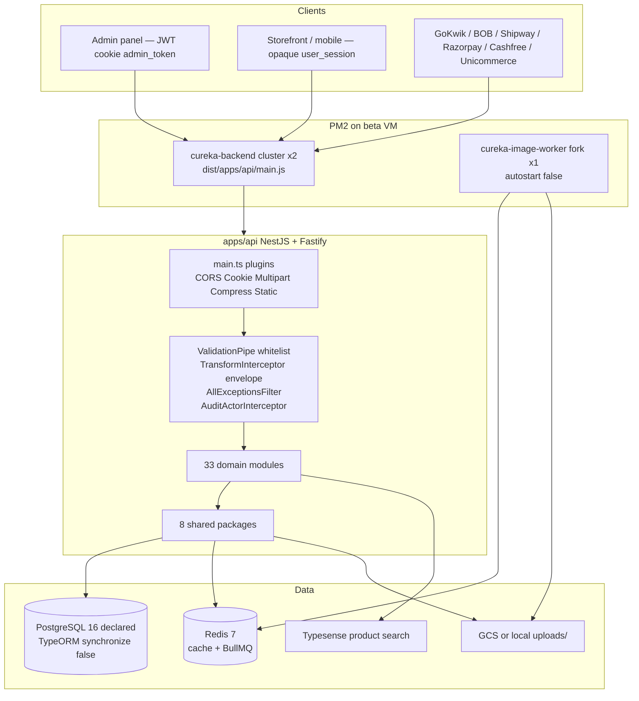
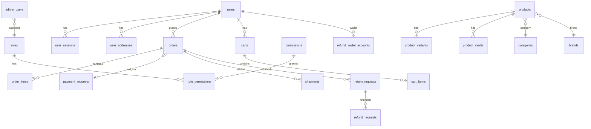

# EMPOWERX — COMPLETE BACKEND ARCHITECTURE, DATABASE, SECURITY, INTEGRATION & PRODUCTION READINESS AUDIT

**Phase 1 — Audit only. No application source, schema, credentials, or deployment configuration were changed.**

| Field | Value |
|---|---|
| Audit date | 2026-10-28 |
| Repository (actual) | `cureka-backend` (workspace: Cureka-backend) |
| Requested product name | EmpowerX |
| Audit branch | `feature/code_review_schema_review` |
| Inspected commit SHA | `12d13c6e224dafb48ef67d6c64ea04708168fcb7` |
| Parent branch at branch-off | `development` |
| Working tree | Clean at branch creation |
| Remote lag at start | Local `development` was **6 commits behind** `origin/development` (fast-forward available). Those 6 commits are **not** in this SHA. |
| Auditor stance | Combined principal backend / security / database / API / SRE / QA review |

---

## SCOPE CLARIFICATION (READ FIRST)

The audit template describes **EmpowerX**: a medical-imaging and case-management platform with Super Admin, Facility Admin, Technician, Specialist, DICOM/images, and clinical AI JSON contracts.

**This repository is not that product.**

Evidence:

- `package.json` name/description: `cureka-backend` — “Production-grade NestJS modular monolith”.
- Swagger title in `apps/api/main.ts`: “Cureka API” / “Healthcare eCommerce marketplace backend”.
- Domain modules: products, cart, checkout, orders, payments (Razorpay / Cashfree / GoKwik), shipping (Shipway), returns, wallet, subscriptions, CMS, Typesense search.
- No facility/technician/specialist/medical-case entities or controllers exist.

EmpowerX-specific items (facility isolation, DICOM, clinical AI JSON, case lifecycle) are marked **NOT APPLICABLE** and mapped to the closest Cureka analogue (customer/admin RBAC, product images, payment webhooks, order lifecycle).

**Declared schema** was inspected from TypeORM entities and migrations. **Deployed schema** was **not** verified (no live database connection in this audit).

**Tests were not executed** (rule: do not run tests that could change shared state; no isolated CI runner was used). Coverage percentages are therefore **not reported**.

No passwords, JWTs, API keys, connection strings, or customer records appear in this document.

---

# Report 1: Executive Summary

## 1.1 Snapshot

| Item | Count / value | How counted |
|---|---|---|
| Repository | cureka-backend | `package.json` |
| Branch | `feature/code_review_schema_review` | `git branch --show-current` |
| Commit | `12d13c6e224dafb48ef67d6c64ea04708168fcb7` | `git rev-parse HEAD` |
| Framework | NestJS 10.4.x + Fastify 4.x | `package.json`, `apps/api/main.ts` |
| Language | TypeScript 5.6, `strict: true` | `tsconfig.json` |
| Database | PostgreSQL via TypeORM 0.3 (declared) | `apps/api/config/database.config.ts` |
| Architecture | Modular monolith (layered controller → service → repository) | `apps/api/app.module.ts`, `modules/*` |
| Domain modules | **33** folders under `modules/` | directory listing |
| Shared packages | **8** (`auth`, `cache`, `common`, `database`, `events`, `logger`, `queue`, `storage`) | `packages/` |
| NestJS module files | **35** `*.module.ts` (includes Unicommerce split modules) | glob |
| Inspected TypeORM entities | **128** `*.entity.ts` | glob |
| Inspected HTTP controllers (non-spec) | **122** | find |
| HTTP method decorators on controllers | **725** | ripgrep `@Get/@Post/@Put/@Patch/@Delete` |
| Migration files | **243** | `apps/api/database/migrations` |
| Unit/spec files | **239** `*.spec.ts` | find |
| Controller spec files | **7** | find |
| E2E tests | **0** (no `test/` directory; `test:e2e` script points at missing `./test/jest-e2e.json`) | glob |
| GitHub Actions workflows | **2** | `.github/workflows/` |
| Confirmed issues in master register | **42** | Report 11 |
| Unverified / blocked risks | **12** | Report 11 (Needs Verification / BLOCKED) |
| Overall engineering score | **6.0 / 10** | Report 13 |
| Production readiness | **NOT APPROVED** | Two verified P0s (BE-001, BE-039) |
| Client audit readiness | **NOT READY** until P0/P1 items and schema-doc drift are addressed | Report 12 |

## 1.2 Production readiness decision

**Do not present this backend as production-ready or as EmpowerX.**

Two verified P0s exist:

1. Customer login OTP is hardcoded to `1234` and is never sent through MSG91 (BE-001). Combined with production `NODE_ENV` suppressing OTP echo in the JSON body, this is either universal account takeover or a broken login path.
2. `GET/POST/PATCH/DELETE /api/v1/staff-users*` has JWT/role guards **commented out** and synthesizes `SUPER_ADMIN` when no caller is present (BE-039). Unauthenticated staff CRUD is live in this SHA.

Additional P1 items (database error leakage, unbounded return-evidence uploads, admin session revocation gaps, webhook raw-body / shared-secret weaknesses, duplicate migration timestamps, deploy/migration coupling, Docker artifact mismatch) would be found quickly by a senior external reviewer.

## 1.3 Top strengths

1. Clear modular-monolith layout with shared packages, global validation whitelist, response envelope, and Pino redaction of secrets/PII keys.
2. Storefront auth uses opaque hashed sessions (not JWT) with purpose isolation for GoKwik checkout tokens.
3. Order/payment status transitions are rank-gated in code (`canTransitionOrderStatus` / `canTransitionPaymentStatus`).
4. Bank account numbers for COD refunds use AES-256-GCM at rest.
5. Beta deploy uses GCP WIF + IAP SSH, builds before PM2 reload, health-checks, and has `rollback.sh`.
6. Public merchandising media path traversal is explicitly rejected (`normalizePublicMediaKey` blocks `..`).
7. TypeScript `strict` + `noImplicitAny` is enabled.

## 1.4 Top weaknesses

1. Hardcoded OTP `1234` with no SMS send on the login path (P0).
2. Unguarded `/staff-users` APIs defaulting the actor to `SUPER_ADMIN` (P0).
3. `QueryFailedError` returns PostgreSQL `detail` to API clients (P1).
4. Auth is opt-in per controller (no `APP_GUARD`); one missed decorator exposes an admin API.
5. Admin JWT default lifetime is 7 days; session revocation is enforced only for configured super-admin emails.
6. 32 duplicate TypeORM migration timestamps; `docs/database-er-diagram.md` still says **33 tables**.
7. Docker/Compose production paths do not match `nest build` output.
8. Almost no controller/e2e/security tests; 239 specs are concentrated in utils/services.
9. God classes: `products.repository.ts` (3711 lines), `product-subscriptions.service.ts` (3600), `orders.service.ts` (3137).

## 1.5 What a client AI reviewer will find in minutes

- Search `generateOtp` → `'1234'`.
- Search `Temporarily disabled so all /staff-users` → unauthenticated SUPER_ADMIN bootstrap.
- Search `QueryFailedError` → driver `detail` in HTTP 500.
- Search `APP_GUARD` → zero matches.
- Open `docs/database-er-diagram.md` → “Total tables: 33” vs 128 entities.
- Open `Dockerfile` `CMD ["node", "dist/main"]` vs `start:prod` = `dist/apps/api/main.js`.
- Search `GOKWIK_WEBHOOK_SECRET` empty accept path.

---

# Report 2: Architecture Review

## 2.1 Implemented pattern

**Hybrid: NestJS modular monolith + layered (controller / service / repository / entity / mapper) + infrastructure packages.**

It is **not** Clean/Hexagonal/DDD as a strict rule. Domain logic lives in services (and sometimes repositories). Shared kernels live in `packages/*`. Cross-module communication uses Nest imports, `forwardRef` (23 files), and `@nestjs/event-emitter`.



Boot sequence (`apps/api/main.ts`):

1. Read CORS / upload / trust-proxy from `process.env` **before** Nest create.
2. `NestFactory.create(AppModule, FastifyAdapter)` with `rawBody: true`, `bufferLogs`, `genReqId`.
3. Register compress, CORS (`credentials: true`), cookie, multipart, optional `/uploads/` static.
4. CSP report parser on `/api/csp-report` (excluded from `api/v1` prefix).
5. Optional Swagger at `/api/v1/docs` only if `SWAGGER_ENABLED=true`.
6. `enableShutdownHooks()`, Pino logger, `listen(0.0.0.0)`, `process.send('ready')` for PM2 `wait_ready`.

`AppModule` loads Config (Joi), Logger, Redis cache, BullMQ, events, TypeORM `autoLoadEntities`, then all business modules. Global pipe is request-scoped `PathAwareLoggingValidationPipe`.

## 2.2 Consistency

**Followed well**

- Most modules use `controllers / services / repositories / entities / dto / mappers`.
- Entities are generally mapped before API responses (not universally guaranteed).
- `synchronize: false` everywhere inspected.
- Storefront vs admin auth are separate mechanisms.

**Violations (evidence)**

| Issue | Evidence |
|---|---|
| Oversized domain services | `modules/orders/services/orders.service.ts` 3137 lines; `modules/subscription/services/product-subscriptions.service.ts` 3600; `modules/product/services/products.service.ts` 2244 |
| Oversized repositories (SQL in “repository” that is really a query service) | `modules/product/repositories/products.repository.ts` 3711 lines |
| Circular dependency workarounds | 23 files use `forwardRef` (e.g. `modules/auth/auth.module.ts` → OrdersModule) |
| Checkout not registered on `AppModule` | `CheckoutModule` is `@Global()` and imported from `AuthModule` only |
| Pincodes not on `AppModule` | Imported from `OrdersModule` and `ProductModule` |
| Stale architecture doc | `docs/backend-architecture.md` still says “seven domain modules” and a scaffolded `apps/worker` |
| No `apps/worker` application | `nest-cli.json` projects: `api` only. `docker-compose.yml` still `command: node dist/apps/worker/main` |
| Commented-out production controller still in tree | First 48 lines of `modules/auth/controllers/admin-auth.controller.ts` |

## 2.3 Folder structure

```
apps/api/          bootstrap, config, database, health, csp-report, image-worker
modules/           33 bounded contexts
packages/          shared infra
scripts/           deploy-beta, rollback, health-check, one-off DB runners
.github/workflows/ beta-deploy.yml, development-release-note.yml
docs/              70+ integration notes; several are stale vs code
```

Naming is generally Nest-conventional. Inconsistencies: `admin_setting` (singular table) vs `admin_notification_emails`; `gallery` singular; permission/status enums reuse `brands_status_enum` on `roles` and `permissions`.

## 2.4 Dependency injection and lifecycle

- Nest default singleton providers; validation pipe is `Scope.REQUEST`.
- TypeORM pool size **5** (PgBouncer-oriented) in `database.config.ts` and `data-source.ts`.
- `app.enableShutdownHooks()` is set; PM2 `kill_timeout` 5000 ms (API) / 15000 ms (image worker).
- Redis health is a separate unauthenticated route (`GET /api/v1/health/redis`).
- Liveness `GET /api/v1/health` does **not** check DB or Redis (documented as process-up only).
- Image worker is a second Nest process (`apps/api/image-worker.ts`), PM2 `autostart: false`.

## 2.5 Configuration architecture

Central Joi schema: `apps/api/config/env.validation.ts` (`abortEarly: true`). Required at boot: `DATABASE_URL`, `JWT_SECRET` (min 32). Many partner secrets are **optional empty strings**, so production can boot without payment/shipping credentials.

Unsafe / surprising defaults:

| Setting | Behaviour | File |
|---|---|---|
| `GOKWIK_CALLBACK_AUTH_REQUIRED` example `false` | Code forces required when `NODE_ENV=production` | `apps/api/config/gokwik.config.ts` |
| `GOKWIK_WEBHOOK_ENABLED` default false | If enabled with empty secret, requests are accepted | `gokwik-webhook.guard.ts` |
| `BOB_AUTH_REQUIRED` example `false` | Forced when `NODE_ENV=production` | `bob.config.ts` |
| `BOB_ABANDONED_CART_ENABLED` default **true** | Scanner starts with API process | `bob.config.ts` |
| `ssl.rejectUnauthorized: false` when `NODE_ENV=production` | TLS cert not verified | `database.config.ts` lines 34, `data-source.ts` line 24 |
| `.env.example` line 13 | Corrupted key `RAZORPAY_PAYMENT_LINK_EXPIRY_MINUGOKWIK_CHECKOUT_TOKEN_TTL_SECONDSTES` | `.env.example` |
| Swagger | Off unless `SWAGGER_ENABLED=true` (good) | `app.config.ts` |

## 2.6 Suitability for a production medical-imaging platform

**This codebase is a healthcare e-commerce marketplace backend, not a medical-imaging / case-management platform.** It is structurally suitable as a high-complexity commerce API **after** P0/P1 security and schema-evolution issues are fixed. It is **not** suitable to be presented as EmpowerX without a different repository (or a documented product rename and missing-domain disclosure).

---

# Report 3: Database Audit

## 3.1 Verification boundary

| Layer | Status |
|---|---|
| TypeORM entities (128) | Inspected |
| Migrations (243 files) | Inspected for timestamps, downs, destructive SQL patterns |
| `synchronize` | Confirmed `false` |
| Live PostgreSQL catalogs / indexes / row counts | **NOT VERIFIED** — no DB session |
| Schema drift (entity vs applied migrations vs production) | **NOT VERIFIED** |

Recommend treating the following as **declared schema**.

## 3.2 Base conventions

`packages/database/src/base.entity.ts`:

| Column | Type | Notes |
|---|---|---|
| `id` | UUID PK | `@PrimaryGeneratedColumn('uuid')` |
| `ref_id` | varchar(16) unique | Public business id |
| `created_at` / `updated_at` | timestamptz | TypeORM |
| `created_by` / `updated_by` | varchar(255) nullable | Audit actor |
| `deleted_at` | timestamptz nullable | Soft delete |

Tables **without** BaseEntity (custom PK / no ref_id): `user_sessions`, `admin_sessions`, `otp_logs`, `product_variants` (UUID PK, no ref_id on variant itself in the first columns), junction/mapping tables, outbox tables.

Money is stored as `decimal(12,2)` strings on orders and as **paise bigint** on wallet/gateway split columns — two units coexist.

## 3.3 Complete table inventory (declared)

### A. Identity, RBAC, sessions

| Table | Purpose | PK | Notable fields / constraints | Sensitive |
|---|---|---|---|---|
| `users` | Storefront customers/staff roles | UUID | Partial unique indexes on email and mobile; `role` enum; optional `role_id` FK | PII |
| `user_addresses` | Shipping/billing addresses | UUID | `user_id` | PII |
| `user_sessions` | Opaque storefront sessions | UUID | `refresh_token_hash` unique; `purpose` login vs gokwik_checkout; `onDelete: CASCADE` | Session secrets (hashed) |
| `admin_users` | Admin panel accounts | UUID | unique email; `password` `select: false`; `role` super_admin/admin/moderator | Password hash |
| `admin_sessions` | Super-admin session rows | UUID | Used by interceptor | Session |
| `otp_logs` | Hashed OTPs | UUID | `otp_code` bcrypt | OTP hash |
| `roles` | RBAC roles | UUID | `slug`; status uses `brands_status_enum` | — |
| `permissions` | Permission catalog | UUID | `code`, `module`, `action` | — |
| `role_permissions` | M2M junction | composite | JoinTable | — |

### B. Catalog and merchandising

| Table | Purpose |
|---|---|
| `products` | Parent product (simple/variable/bundle) |
| `product_variants` | SKU, price, stock, OOS, HSN, expiry |
| `product_media` | Images/videos per product/variant |
| `product_bundles` | Bundle component lines |
| `product_faqs` / `product_faq_mappings` | PDP FAQs |
| `product_tags` / `product_tag_mappings` | Tags |
| `product_attribute_mappings` | Product ↔ attributes |
| `product_category_hierarchies` | Multi-category |
| `product_category_filter_mappings` | Facet bindings |
| `product_health_concerns` / `product_wellness_goals` | Taxonomy maps |
| `product_information_labels` | Label master |
| `product_reviews` | Reviews |
| `product_pincodes` | Serviceability |
| `variant_attribute_values` | Variant option values |
| `wishlist_items` | Wishlist |
| `bulk_uploads` | Admin Excel jobs |
| `categories` / `category_filters` | Catalog tree + filters |
| `brands` / `manufacturers` / `packers` / `importers` | Masters |
| `attributes` / `units` / `product_natures` | Masters |
| `health_concerns` / `age_groups` / `wellness_goals` | Taxonomy |
| `banners` / `home_sections` | Homepage CMS |
| `cms_pages` | Static pages |
| `gallery` | Media library |
| `watch_and_shop_items` / `expert_talk_items` | Content rails |
| `testimonials` | Social proof |
| `blog_posts` / `blog_categories` / `blog_comments` / `blog_post_products` | Blog |
| `coupons` / `coupon_products` / `coupon_categories` / `coupon_brands` | Coupons |
| `promotional_offers` / `promotional_offer_targets` / `promotional_offer_reservations` | Native promos (flag-gated) |
| `promotional_pages` / `_sections` / `_section_items` / `_targets` | Landing pages |

### C. Commerce

| Table | Purpose |
|---|---|
| `carts` / `cart_items` | Cart |
| `saved_for_later_items` | Save for later |
| `orders` / `order_items` | Orders |
| `order_fulfillment_events` | Fulfillment timeline |
| `coupon_usages` | Coupon redemption |
| `payment_requests` / `payment_request_items` | Payment links / checkout intents |
| `shipments` / `shipment_items` / `shipment_events` | Shipway shipments |
| `shipway_webhook_unresolved` | Unmatched webhooks |

`orders` key fields (`modules/orders/entities/order.entity.ts`): unique `order_number`; `user_id`; money columns; unique `payment_request_id`; wallet/gateway paise; coupon snapshot fields; enums `payment_method`, `payment_status`, `order_status`, `order_source`; recipient PII; status timestamp columns (added in migration `1785968000000`).

Order status enum: `PENDING, CONFIRMED, PROCESSING, SHIPPED, OUT_FOR_DELIVERY, DELIVERED, CANCELLED, FAILED_DELIVERY, RTO`.

Payment status enum: `PENDING, PARTIALLY_PAID, PAID, FAILED, REFUND_PENDING, PARTIALLY_REFUNDED, REFUNDED`.

### D. Returns, refunds, wallet

| Table | Purpose | Sensitive |
|---|---|---|
| `return_requests` / `return_request_items` | Return/replace workflow | Bank last4 + encrypted PAN |
| `return_status_history` | Status audit | — |
| `return_pickups` / `return_evidences` / `return_qc_records` | Logistics/QC | Evidence files |
| `refund_requests` / `refund_request_history` | Refund cases | — |
| `refund_wallet_accounts` / `refund_wallet_ledger` / `refund_wallet_reservations` | Wallet | Financial |
| `cod_refund_payouts` | COD bank payouts | Financial |
| `cod_blocklist_entries` | COD fraud list | PII |

Return status enum is large (REQUESTED → COMPLETED / CANCELLED_BY_CUSTOMER) in `modules/returns/enums/return-status.enum.ts`.

Bank encryption: AES-256-GCM `v1:iv:tag:ciphertext` (`bank-account-encryption.util.ts`). Key is optional in Joi (`allow('')`) — COD bank capture fails closed only when encrypt is called.

### E. Subscriptions / membership

`product_subscription_configs`, `user_product_subscriptions`, `subscription_mandates`, `subscription_payments`, `subscription_billing_cycles`, `subscription_status_history`, `subscription_webhook_events`, `membership_plans`, `membership_benefits`, `user_memberships`, `membership_payments`.

Module hidden unless `SUBSCRIPTIONS_MODULE_ENABLED=true` (default false).

### F. Integrations, ops, geo

| Table | Purpose |
|---|---|
| `gokwik_orders` / `gokwik_refunds` / `gokwik_webhook_events` / `gokwik_abandoned_carts` / `gokwik_sync_states` | GoKwik persistence |
| `bob_notify_outbox` / `bob_abandoned_cart_outbox` | WhatsApp notify durability |
| `vendors` / `vendor_warehouses` / `vendor_category_hierarchies` | Marketplace vendors |
| `pincodes` / `pincode_offices` | India Post-style geo |
| `image_assets` / `image_pipeline_checkpoints` | Image worker |
| `admin_setting` | Key/value feature flags |
| `admin_notification_emails` | Alert recipients |
| `audit_logs` / `audit_outbox` | DPDP-oriented audit |
| `support_*` / `ticket_messages` | Support desk |
| `reason_masters` | Cancellation/return reasons |
| `countries` / `states` / `cities` | Geography |
| `subscription_frequencies` | Delivery cadence master |

**Entity count: 128 files. Junction `role_permissions` is JoinTable-only (no dedicated entity file).** Additional DB objects may exist only in SQL migrations (indexes, enums, `pg_trgm`). **Needs Verification** against `information_schema` on staging.

## 3.4 Relationships and integrity

**Enforced in entities (examples):** `user_sessions.user_id` ManyToOne CASCADE; `admin_users.role_id` ManyToOne; `orders.user_id` indexed (FK presence in DB: **Needs Verification** — TypeORM `@JoinColumn` does not always emit FK if migrations omitted it).

**Application-level without guaranteed DB FK (probable):** `products.vendor_id` is UUID nullable with `@Index()` but **no** `@ManyToOne` to `vendors` in the first 80 lines of `product.entity.ts`. `orders.coupon_id` is UUID without a shown JoinColumn in the excerpted columns.

**Cascade risk:** session rows delete with user (`onDelete: CASCADE`). Soft-delete on BaseEntity means hard FK deletes are uncommon for catalog; **Needs Verification** for order/user delete scripts (`apps/api/database/scripts/user-purge.runner.ts` exists — destructive; not executed).

**Polymorphic:** storage file references are JSON columns (`storageFileReferenceColumn`) rather than a files table.

## 3.5 Normalization

Mostly 3NF with intentional denormalization:

- Order coupon title/code/discount type copied onto `orders`.
- Promotion snapshot JSONB.
- Address copied onto orders/payment requests at checkout (correct for historical invoices).
- `roles.status` / `permissions.status` reuse `brands_status_enum` — enum sharing is a schema smell, not a functional bug.

JSON/JSONB usage is justified for snapshots and CMS payloads; overuse risk on product information items stored as JSON on variants.

## 3.6 Indexing and query performance (declared only)

Observed entity indexes: users email/mobile partial unique; orders `order_number` unique, `user_id`, `order_status`, `order_source`; product slug/type/category; sitemap keyset index migration `1785953000000-add-products-sitemap-keyset-index.ts`; `pg_trgm` migration `1785994000000-enable-pg-trgm.ts`.

**Probable risks (no EXPLAIN ran):**

- Offset pagination via `buildSkipTake` (`packages/database/src/query.util.ts`) — large `page` on `orders`/`products` can degrade.
- `findAllPublishedRefIds()` loads **all** published product refIds then the Unicommerce controller loops `enqueuePushProduct` (`unicommerce-catalog.controller.ts` 30–36).
- `PermissionsGuard` loads `roleRecord.permissions` on **every** authorized admin request.
- Admin dashboard service is 1316 lines of aggregations — **Needs Verification** with 10k+ orders.
- Google Merchant feed builds full XML per request (`google-merchant-feed.controller.ts`).

Do **not** treat these as measured slowness.

## 3.7 Data integrity

**Good:** unique order numbers; unique payment_request_id on orders; OTP attempt counter; payment/order monotonic ranks; Gokwik/BOB outbox tables.

**Gaps:**

- Duplicate migration timestamps (32 timestamp values shared by 2–4 files) — TypeORM ordering among equal timestamps is filename-dependent. **Confirmed process risk.**
- `generateOtp` constant undermines OTP uniqueness/entropy (BE-001).
- Admin login has **no** lockout / throttling in `admin-auth.service.ts` (unlike customer OTP rate limit).
- Wallet checkout flag default false — financial path may be incomplete (`WALLET_CHECKOUT_ENABLED`).
- Race conditions on stock: `STOCK_INVENTORY_MANAGEMENT_ENABLED` exists; Unicommerce is described as stock system of record in `.env.example`. Concurrent checkout vs Unicommerce **Needs Verification**.

## 3.8 Migrations

- CLI: `apps/api/database/data-source.ts`; `migrationsTransactionMode: 'each'` (enum ADD VALUE safety).
- `migration:run` is **always** executed on beta deploy **before** PM2 reload (`scripts/deploy-beta.sh`).
- Downs typically `DROP TABLE IF EXISTS` — rollback.sh **does not revert migrations**; it only resets git SHA and rebuilds. Forward-only schema = rollback cannot undo additive SQL.
- Duplicate timestamps listed in Report 11 (BE-009).
- One-off data script `product:no-return-no-cod --once` runs on every successful migrate path until a DB marker exists — coupling deploy to a product-policy job.

## 3.9 Sensitive data storage

| Data | Protection | Assessment |
|---|---|---|
| Admin passwords | bcrypt 12 (`packages/common/src/hash.util.ts`), `select: false` | Good |
| Customer passwords | **None** — OTP auth | N/A except OTP |
| OTP | bcrypt 10, but plaintext generator is `'1234'` | Broken |
| Sessions | SHA hash of refresh token | Good |
| Bank account | AES-256-GCM | Good if key set |
| PII on users/orders | DB at rest depends on disk/backup encryption — **NOT VERIFIED** | Blocked |
| Medical images / DICOM | Not in this product | N/A |
| File storage | GCS private + public media allowlist | Good design |
| Backups / PITR | Not in repo | BLOCKED |

## 3.10 Client database access plan (least privilege)

**Do not grant production access.**

Prerequisites (owners TBD — not invented as agreed dates):

1. **Engineering / DBA:** provision a **staging** database restored from a **sanitized** snapshot (scramble mobiles, emails, names, addresses; drop `otp_logs`, session hashes, encrypted bank columns or replace with fake ciphertext; no live payment tokens).
2. **Security:** create PostgreSQL role `client_review_readonly` with `CONNECT` + `USAGE` on schema + `SELECT` on information_schema/pg_catalog and selected business tables. **No** `INSERT/UPDATE/DELETE/TRUNCATE`. **No** `pg_read_server_files`. **No** superuser.
3. Confirm whether row-level security exists (entities show **no** RLS policies in repo → assume **not implemented**). Tenant isolation is not facility-based; customer data is global to Cureka. A client SELECT on `users`/`orders` sees **all customers** unless views are created.
4. Prefer a **schema-only dump** (`pg_dump --schema-only`) plus a handful of **synthetic** rows for the first review pass.
5. Deliver credentials via a secret manager / one-time vault link, never email/chat/git. Set a **role expiry** (`VALID UNTIL`) and revoke after the review window.
6. Enable PostgreSQL logging of that role (`log_statement` or pgaudit) if available on staging.
7. Approval placeholders: DBA owner ____, Security owner ____, Product owner ____, Legal/DPDP owner ____.
8. Timeline: **to be confirmed by the team** after sanitization job is estimated. This audit does not set a delivery date.

**Database readiness score: 6.8 / 10** (declared model is coherent; migration hygiene, drift docs, and unverified live schema prevent a higher score).



---

# Report 4: Security Assessment

## 4.1 Authentication

### Storefront (customers)

- Identifier → OTP (`POST /api/v1/auth/login`, `POST /api/v1/auth/send-otp`).
- OTP hashed with bcrypt 10; expiry 5 minutes; 5 attempts; Redis cooldown + IP/mobile caps (`OTP_*` env).
- **Generator always returns `'1234'`** (`modules/auth/utils/otp.util.ts` line 20).
- **MSG91 is not called** from `AuthService.sendOtp` — only `otpService.sendOtp` + log `OTP dispatched`.
- OTP plaintext is echoed in JSON when `NODE_ENV !== 'production'` (`auth.service.ts` 365–367). Beta PM2 sets `NODE_ENV=production`, so echo is off on beta **but the code is still 1234**.
- Session: opaque token in HttpOnly `user_session` cookie, `sameSite=lax`, `secure` from `COOKIE_SECURE` or `X-Forwarded-Proto`. Also accepted as `Authorization: Bearer`.
- GoKwik checkout tokens stored as `purpose=gokwik_checkout` and **rejected** by `SessionCookieGuard` for normal APIs.

### Admin

- Email/password, bcrypt 12, inactive-account check at login.
- JWT in HttpOnly `admin_token` cookie **and** Bearer (`JwtStrategy` extractors).
- Default `JWT_EXPIRES_IN=7d` (`jwt.config.ts`). No `algorithms` allowlist in strategy (passport-jwt defaults HS256 — **Probable** OK, not explicit).
- No issuer/audience.
- Super-admin session rows + `AdminSuperadminSessionInterceptor` — **only** for emails matching `isSuperAdminSessionAccount`. Other admins: JWT valid until expiry even if password rotated, unless a separate check exists (not found in JwtStrategy).
- Logout clears cookie and `recordCookieLogout` — session row path is super-admin-centric.
- **No** admin login throttling.

KwikPass JWE exchange exists (`kwikpass.service.ts`) with jose — separate from OTP.

## 4.2 Authorization

No `APP_GUARD`. Every controller must `@UseGuards(JwtAuthGuard, RolesGuard, PermissionsGuard)` or `SessionCookieGuard`.

`RolesGuard`: if no `@Roles()`, allows any authenticated user.

`PermissionsGuard`: empty `@RequirePermissions` → allow; `SUPER_ADMIN` JWT role **bypasses** permission list; others load permissions from DB.

### Role × resource matrix (from code, not a policy engine)

| Role | Mechanism | Typical access |
|---|---|---|
| Anonymous | No guard | Public catalog, homepage, search, CMS, health, payment **webhooks** (signature), CSP report |
| Customer (session) | `SessionCookieGuard` + often `VerifiedUserGuard` | Own cart/orders/returns/wallet/profile |
| Guest | `isGuest` on user | Checkout-dependent; `allowGuestLogin` admin setting |
| Admin / Moderator | JWT + `@Roles` + permissions | Admin APIs matching permission codes (`orders.read`, etc.) |
| Super Admin | JWT role bypass in PermissionsGuard | All admin permissions |
| Vendor / telecaller / warehouse enums | `UserRole` on `users` | Staff CRUD exists; **BE-039: `/staff-users` guards are commented out** |
| GoKwik | Callback/webhook/checkout-token guards | Cart/order callbacks |
| BOB | `BobApiKeyGuard` / webhook secret | Catalog + webhooks |
| Unicommerce bulk-sync | `x-admin-secret` === `UNICOMMERCE_PASSWORD` | Enqueue all products |

**Facility isolation:** NOT APPLICABLE (no facilities). Closest analogue: **customer object-level isolation** on `OrdersService.findOne(user.sub, id)` — storefront passes session `sub`, not a client-supplied userId on that handler. Admin list endpoints see **all** orders (intended). Vendor seeing another vendor’s products: **Needs Verification**.

## 4.3 Findings (security-focused; full register in Report 11)

Critical/High summarized:

- **BE-001 P0** hardcoded OTP + no SMS.
- **BE-039 P0** `/staff-users` unauthenticated + synthetic `SUPER_ADMIN`.
- **BE-002 P1** DB error `detail` in HTTP body.
- **BE-040 P1** return evidence `maxFileSizeOverride: Number.MAX_SAFE_INTEGER`.
- **BE-004 P1** admin session revocation incomplete.
- **BE-005 P1** Unicommerce admin secret is the integration password; `!==` compare; unauthenticated except that header.
- **BE-006 P1** GoKwik webhook enable-without-secret accept path.
- **BE-007 P1** Shiprocket webhook HMAC over `JSON.stringify(payload)` not raw body.
- **BE-012 P1** no admin brute-force limiter.
- **BE-015 P2** Cashfree HMAC uses `!==` not `timingSafeEqual`.
- **BE-016 P2** Unicommerce secret compare not constant-time.
- **BE-017 P2** CORS allows custom secret headers (`x-bob-webhook-secret`, `x-webhook-secret`) — extra attack surface for browser-based exfil if XSS exists on an allowed origin.
- **BE-018 P2** `GET /health/redis` unauthenticated (info leak of Redis connectivity).
- **BE-008 P2** `rejectUnauthorized: false`.
- **BE-003 P2** missing global auth guard.

Mass assignment: whitelist + `forbidNonWhitelisted` except Unicommerce/GoKwik/BOB/Shipway webhook paths (`path-aware-logging-validation.pipe.ts`). Implicit conversion **disabled**. Good.

SQL injection: QueryBuilder parameterization is the dominant pattern. Raw `queryRunner.query` in migrations only. **Probable** safe; not a full string-concat audit of 3711-line repository.

File upload: admin JWT + permissions; multipart size from env; folder enum `ParseEnumPipe(UploadFolder)`. Malware scanning: **MISSING**.

SSRF: outbound URLs from env (Shipway, GoKwik, Unicommerce). User-controlled URL fetch **Needs Verification** in blog/video URL fields.

## 4.4 File / image security

- Public stream `GET /api/v1/public/media/*` with prefix allowlist; `..` rejected; private prefixes (avatars, return-evidence, vendor-documents) denied. Tests in `public-media.util.spec.ts`.
- Local driver serves `/uploads/` via `@fastify/static` — **if production still uses local driver, files under uploadDir are world-readable** without the allowlist. GCS is the documented production driver.
- No DICOM/EXIF stripping identified for clinical use (N/A); merchandising images go through optional sharp pipeline.

## 4.5 Security logging

- Pino redact list includes otp, password, tokens, email, phone, signedUrl (`logging.constants.ts`).
- AuditService + outbox for critical actions (cursor rule `audit-logging.mdc`).
- Admin login failures audited (`auditLoginFailure`).
- Customer OTP verify failures persist `otp_failed`.
- **Failed authorization** (403 from PermissionsGuard) — not confirmed as audit events.
- Patient/clinical access logs: N/A.

---

# Report 5: API Contract Assessment

Global prefix: `api/v1` (`APP_CONSTANTS.API_PREFIX`).

Success envelope: `{ success, data, message, timestamp }` via `TransformInterceptor`, skippable with `@RawResponse()` (health, webhooks, Google Merchant XML, public media).

Error envelope: `{ success: false, statusCode, error, message, timestamp, path, ... }` except GoKwik `{ data: { error } }` and BOB `{ status: failure }`.

Validation: class-validator DTOs + whitelist. Quality varies; large DTOs (`product.dto.ts` 920 lines).

Pagination: `page`/`limit` with default 20 / max 100 in constants; **offset-based**. Inconsistent query DTO names across modules.

Swagger: generated only when enabled; many controllers have `@ApiTags` / `@ApiBearerAuth`. Webhooks excluded (`@ApiExcludeController` on payments webhook). **Schema drift vs Swagger: NOT VERIFIED** (Swagger not generated in this audit).

### Controller inventory (prefix → file)

Public / unauthenticated (by design unless noted):

| Prefix | Controller |
|---|---|
| `health` | `apps/api/health/health.controller.ts` |
| `api/csp-report` | `csp-report.controller.ts` |
| `public/*` | homepage, products, bundles, search, vendors, pincodes, blog, cms, support, checkout, media, sitemap, merchant feed, watch-and-shop, expert-talk, footer, common, product reviews |
| `auth` | login, OTP, KwikPass, refresh, guest config |
| `payment/webhook*` | Razorpay/Cashfree/Shiprocket |
| `gokwik/webhooks` | GoKwik events |
| `shipments/webhook` | Shipway |
| `bob` / `bob/webhooks` | BOB (guarded by API key / secret when configured) |
| `unicommerce/admin/bulk-sync` | shared-secret header |

Authenticated storefront: `cart`, `orders`, `wishlist`, `save-for-later`, `users`, `users/addresses`, `returns`, `wallet`, `payment-requests`, `subscriptions/products`, `memberships`, `support/tickets`.

Admin (JWT + roles + permissions, typical): `admin/*`, `admin-users`, `roles`, `permissions`, `products`, `bundle-products`, `product-*`, `master/*`, `gallery`, `uploads`, `staff-users`, `gokwik/admin`, reports, dashboard, refunds, wallets, vendors, etc.

**725 method decorators** across **122** controllers. Listing every method/query/body here would duplicate Swagger; the gap is **no committed OpenAPI artifact** and **no e2e contract tests**.

API design issues:

- Dual auth styles (session vs JWT) are intentional, not inconsistency.
- Versioning is a single `v1` prefix — no strategy for breaking changes.
- `product-faqs` `@Controller()` empty prefix — routes hang off method paths; easy to mis-document.
- Duplicate `@Controller('gokwik')` on cart, order, wallet.
- Admin vs master prefixes mixed (`product-reviews` vs `admin/product-reviews`).

---

# Report 6: AI Integration Assessment

**There is no EmpowerX-style clinical AI service in this repository.**

Searches for openai / anthropic / gemini / llm / embeddings as product integrations did not yield an AI inference client. Closest systems:

| System | Role | AI? |
|---|---|---|
| Typesense | Product search index (`TYPESENSE_*`, BullMQ `typesense` queue) | No — search engine |
| Image pipeline | sharp WebP derivatives | No — transcoding |
| MSG91 / BOB | SMS / WhatsApp | No |

**Structured JSON “AI response schema”: NOT APPLICABLE.**

Partner JSON that **does** exist and should be validated as integration contracts:

- GoKwik webhooks/DTOs (`modules/gokwik/dto/*`)
- Razorpay / Cashfree webhook payloads (`payments-webhook.controller.ts`)
- Shipway webhook DTO
- Unicommerce order/product APIs
- BOB notify payloads

Failure-mode matrix (partners, not clinical AI):

| Failure | Handling evidence | Gap |
|---|---|---|
| Invalid JSON | ValidationPipe | Extra keys allowed on partner prefixes |
| Timeout | per-integration `TIMEOUT_MS` | Inconsistent |
| Duplicate webhook | Gokwik event tables; subscription_webhook_events | Not proven idempotent for every provider |
| Retry | BullMQ queues (gokwik, unicommerce, sitemap, typesense, image-pipeline, BOB abandoned cart) | Image retry env exists |
| Fallback model | N/A | N/A |
| Clinical bypass | N/A | N/A |

**Handoff:** EmpowerX AI repository audit is **out of scope**. Cureka has no AI JSON schema to hand to that team.

---

# Report 7: Business Logic Assessment

## 7.1 Users and facilities

- **No facilities.** Users: customer (OTP), guest, staff `UserRole` values, admin_users.
- Registration: OTP verify → complete registration DTO.
- Activation: `UserStatus` on users; admin `isActive`.
- Password reset: N/A for customers; admin script `admin:reset-superadmin-password`.
- Duplicate mobiles/emails: partial unique indexes.

## 7.2 “Case” analogue = Order lifecycle

```
Cart → checkout validate → payment request / GoKwik / COD
  → order PENDING
  → payment webhook / COD confirm → CONFIRMED / PROCESSING
  → Shipway / Unicommerce → SHIPPED → OUT_FOR_DELIVERY → DELIVERED
  → FAILED_DELIVERY / RTO
  → CANCELLED (pre-ship; integration retry)
```

Transitions are **not** free-form client status writes on storefront. Admin cancel/complete endpoints exist (`admin-orders.controller.ts`) with `orders.update`. Rank function prevents regression (e.g. CANCELLED is terminal).

**Invalid transitions:** `canTransitionOrderStatus` still allows some lateral moves among equal rank (DELIVERED vs FAILED_DELIVERY both rank 5). **Probable** logic bug / product question (P2).

Notifications: MSG91 order SMS; BOB WhatsApp outbox on fulfillment.

## 7.3 Technician analogue = warehouse / vendor / bulk upload

Bulk Excel upload with Redis lock TTL; Shipway warehouse ids; Unicommerce tenant/channel. Offline mobile sync / scanned-date / patient age: **NOT APPLICABLE**.

## 7.4 Specialist analogue = none

Reports module is **commerce reports**, not clinical reports.

## 7.5 Isolation

Storefront order GET uses session user id. **IDOR risk** if any endpoint takes `userId` from query; not confirmed on `OrdersController.findOne`. Admin is omniscient by design.

---

# Report 8: Performance Assessment

No load-test results exist in-repo. **No latency/RPS numbers are claimed.**

### 10,000-case (order/product) readiness — analytical

| Workload | Declared behaviour | Risk |
|---|---|---|
| 10k stored orders | Offset pagination max 100 | Deep offsets expensive — probable |
| List all without pagination | `findAllPublishedRefIds` / merchant XML / some BOB catalog paths | Confirmed unbounded loaders exist |
| Dashboard aggregations | Large SQL in `admin-dashboard.service.ts` | Unverified at 10k |
| Typesense search | Offloaded if enabled | Depends on Typesense sizing |
| Image worker | concurrency 1–8 | Separate process |
| DB pool | 5 app connections + PgBouncer in compose | Compose is not proven = production (beta is PM2 on VM) |
| Cache | Redis cache-aside for homepage/products; TTLs in Joi | Tenant keys N/A (single tenant) |

### Concurrency

- Checkout vs stock: Unicommerce SoR vs local `stock`/`outOfStock` — race **Needs Verification**.
- Payment webhooks: rank skip on regression; duplicate PAID **Probable** handled.
- OTP: cooldown reduces duplicate sends (of 1234).
- Bulk upload lock TTL 30 min.

### Safe staging load-test plan (do not run on production)

1. Seed **10,000 products** + **10,000 orders** on isolated staging.
2. Measure p50/p95/p99 for `GET /api/v1/public/products`, `GET /api/v1/admin/orders`, `GET /api/v1/orders` (paginated), dashboard, search.
3. Concurrent COD + prepaid checkouts (50–200 VUs).
4. Concurrent Shipway webhook replays (idempotency).
5. Unicommerce bulk-sync (expect queue saturation).
6. Watch PG connections, Redis memory, Node heap, error rate.
7. Stop conditions: 5xx > 1%, p95 > agreed SLO, pool wait.

---

# Report 9: CI/CD and Operational Reliability

## 9.1 Actual pipelines

| Workflow | Trigger | Action |
|---|---|---|
| `.github/workflows/beta-deploy.yml` | push `beta_development` | WIF → IAP SSH → `scripts/deploy-beta.sh` as user `tech` → curl health |
| `.github/workflows/development-release-note.yml` | PR merged to `development` | Release note email; no deploy |

**No GitHub Actions test/lint/build gate on PRs** was found. Quality relies on local Jest.

## 9.2 Deploy safety (`scripts/deploy-beta.sh`)

Positive:

- `git fetch` + `reset --hard` + `clean -fd` (ignored files such as `.env` are **not** removed by `-fd`).
- `npm ci` → `npm run build` → require `dist/apps/api/main.js` → migrations → `pm2 reload` (not stop) → health-check → rollback on failure.
- Concurrency group `cancel-in-progress: false`.
- Image worker **not** reloaded (workflow summary).

Negative:

- Migrations run **before** new process is proven. Failed health after a destructive/additive migration leaves DB forward and code rolled back (**BE-010**).
- `rollback.sh` does not `migration:revert`.
- `git reset --hard` on the live checkout means a failed `npm ci` after reset already moved HEAD; rollback uses PREVIOUS_SHA — OK if recorded.
- Extra `product:no-return-no-cod --once` can fail the whole deploy.
- Health check is liveness only (no DB). A process can be “healthy” while Postgres is down.

## 9.3 Docker vs VM reality

Beta is **PM2 on a GCE VM**, not the Compose stack.

| Artifact | Problem |
|---|---|
| `Dockerfile` CMD | `node dist/main` — Nest emits `dist/apps/api/main.js` |
| `Dockerfile` HEALTHCHECK | `/api/v1/health` OK if CMD were correct |
| `docker-compose.yml` worker | `dist/apps/worker/main` — **no worker app** |
| Non-root user in image | Good |
| Compose Postgres password default `postgres` | Dev-only; do not use in prod |

## 9.4 Operational security

- WIF + IAP; no long-lived GitHub SSH key in workflow. Good.
- `secrets/` gitignored.
- Host key: `gcloud compute ssh --quiet` — **Needs Verification** of host-key policy.
- PM2 logs under `logs/` gitignored.
- `.env` not in git.

## 9.5 Recovery

- PM2 `autorestart`, `max_memory_restart` 1G / 1.5G.
- `wait_ready` + `listen_timeout` 10s — slow boot can be killed.
- DB reconnection: TypeORM default — **Needs Verification**.
- Backups: **not in repo** → BLOCKED.
- Disk-full / OOM: not scripted beyond PM2 memory restart.

---

# Report 10: Testing Assessment

| Class | Count | Notes |
|---|---|---|
| `*.spec.ts` | 239 | Jest `testRegex` `(apps\|packages\|modules)/.*\.spec\.ts$` |
| Controller specs | 7 | Extremely thin HTTP layer coverage |
| E2E | 0 | `test/` missing |
| Load / security / contract tests | 0 | — |

Specs cluster in product (30), subscription (19), orders (19), gokwik (17), returns (14). `users` has 1 spec. `payment-requests` 1 spec despite 2747-line service.

**None of these were executed in this audit.**

### Critical scenario matrix

| # | Scenario | Status |
|---|---|---|
| 1 | Unauthorized user accessing a case/order | Partial — unit guards exist; no e2e |
| 2 | Facility A vs B | NOT APPLICABLE |
| 3 | Technician unassigned case | NOT APPLICABLE |
| 4 | Specialist restricted case | NOT APPLICABLE |
| 5 | Invalid payload | Partial — pipe specs exist |
| 6 | Invalid JWT | Missing e2e |
| 7 | Expired token | Missing e2e |
| 8 | Duplicate order submission | Partial — payment rank tests |
| 9 | Missing upload file | Partial — upload-size util spec |
| 10 | Invalid image | Partial |
| 11 | Large file | Partial util |
| 12 | Transaction failure | Missing |
| 13 | AI timeout | NOT APPLICABLE |
| 14 | Invalid AI JSON | NOT APPLICABLE |
| 15 | Missing AI fields | NOT APPLICABLE |
| 16 | Duplicate AI completion | NOT APPLICABLE — webhook dup: Partial |
| 17 | Simultaneous case updates | Missing |
| 18 | 10k pagination | Missing |
| 19 | Offline sync | NOT APPLICABLE |
| 20 | Restart during background job | Missing |
| — | Hardcoded OTP 1234 | **Missing** (would fail a security test) |
| — | Cross-customer order IDOR | Missing e2e |
| — | Admin brute force | Missing |

---

# Report 11: Master Findings Register

Severity: P0 Critical · P1 High · P2 Medium · P3 Low. Confidence: Confirmed / Probable / Needs Verification.

### BE-001 — Hardcoded customer OTP `1234` and no SMS dispatch

| Field | Content |
|---|---|
| Category | Security |
| Severity | **P0** |
| Confidence | Confirmed |
| File | `modules/auth/utils/otp.util.ts` L16–20; `modules/auth/services/otp.service.ts` L41; `modules/auth/services/auth.service.ts` L69–81 |
| Evidence | `export const generateOtp = (): string => '1234';` TODO comment to use `crypto.randomInt`. `AuthService.sendOtp` never injects `Msg91SmsService`. |
| Root cause | Temporary test OTP left on the production code path. |
| Impact | Any party who can hit login+verify can authenticate as any customer after requesting OTP. If SMS were wired later without changing the generator, every SMS would be 1234. |
| Reproduction (safe, staging only) | On a non-production environment, request OTP for a test mobile, submit `1234`. Do not run against production customer accounts. |
| Recommendation | Generate cryptographically random OTP; send via MSG91; never return OTP in JSON in beta/staging/production; add e2e test that OTP is not constant; rotate any accounts that used 1234. |
| Dependencies | notifications/MSG91, storefront |
| Effort | Small |
| Regression tests | OTP uniqueness, SMS mock, production response must not include `otp` |
| Client visibility | **Yes — trivial grep** |

### BE-002 — PostgreSQL driver errors returned to clients

| Field | Content |
|---|---|
| Category | Security / API |
| Severity | P1 |
| Confidence | Confirmed |
| File | `apps/api/common/filters/all-exceptions.filter.ts` L161–168 |
| Evidence | `QueryFailedError` maps `driverError.detail` to `message` with HTTP 500. Generic `Error` returns `exception.message`. |
| Impact | Constraint names, column values snippets, internal schema leaked. Aids attackers and looks unprofessional in client review. |
| Recommendation | Return generic “Internal server error”; log detail server-side only. |
| Effort | Small |
| Client visibility | Yes |

### BE-003 — Authentication is opt-in (no global guard)

| Field | Content |
|---|---|
| Category | Security |
| Severity | P2 |
| Confidence | Confirmed |
| File | `apps/api/app.module.ts` (no `APP_GUARD`); `packages/auth/src/auth.module.ts` |
| Evidence | Zero `APP_GUARD` matches in `*.ts`. |
| Impact | A new admin controller without `@UseGuards` is public. Current admin controllers inspected generally set guards; this is a process hazard. |
| Recommendation | Register JwtAuthGuard globally with `@Public()` opt-out for storefront/webhooks. |
| Effort | Medium |
| Client visibility | Yes |

### BE-004 — Admin JWT not bound to a revocable session (except super-admin emails)

| Field | Content |
|---|---|
| Category | Security |
| Severity | P1 |
| Confidence | Confirmed |
| File | `packages/auth/src/strategies/jwt.strategy.ts`; `modules/auth/interceptors/admin-superadmin-session.interceptor.ts` L16 |
| Evidence | Strategy returns payload without DB lookup. Interceptor returns early unless `isSuperAdminSessionAccount(user.email)`. JWT default 7d. |
| Impact | Stolen/lingering admin JWT works after logout/disable until expiry for non-super-admin. |
| Recommendation | Session table for all admins; check `isActive` on each request; shorten access TTL; rotate on password change. |
| Effort | Medium |
| Client visibility | Yes |

### BE-005 — Unicommerce bulk-sync authenticated with integration password

| Field | Content |
|---|---|
| Category | Security / API |
| Severity | P1 |
| Confidence | Confirmed |
| File | `modules/unicommerce/controllers/unicommerce-catalog.controller.ts` L20–36 |
| Evidence | `x-admin-secret` compared with `UNICOMMERCE_PASSWORD` using `!==`. Loads all published refIds, enqueues one job each. No JWT. |
| Impact | Password reuse; timing leak; unauthenticated DoS/queue flood if secret leaks; secret may be empty → all requests 403 (fail closed) **unless** misconfigured equal empty — `!secret` catches empty. |
| Recommendation | Admin JWT + permission; constant-time compare; paginated enqueue. |
| Effort | Small |
| Client visibility | Yes |

### BE-006 — GoKwik webhooks accepted without shared secret when enabled

| Field | Content |
|---|---|
| Category | Security |
| Severity | P1 |
| Confidence | Confirmed (code path); production exploit depends on env |
| File | `modules/gokwik/guards/gokwik-webhook.guard.ts` L51–73 |
| Evidence | If `webhookEnabled` and `expectedSecret` empty, logs warning and **returns true**. Comment: HMAC formula “added later”. Default enabled=false. |
| Impact | If ops set `GOKWIK_WEBHOOK_ENABLED=true` without secret, anyone can post payment/refund events. |
| Recommendation | Fail closed; require secret in production; verify body HMAC. |
| Effort | Small |
| Client visibility | Yes |

### BE-007 — Shiprocket webhook HMAC over reserialized JSON

| Field | Content |
|---|---|
| Category | Security |
| Severity | P1 |
| Confidence | Confirmed |
| File | `modules/payment-requests/controllers/payments-webhook.controller.ts` L47–48 |
| Evidence | `const rawBody = JSON.stringify(payload)` then `verifyCallbackSignature`. Razorpay/Cashfree/Shipway use `req.rawBody` (better). |
| Impact | Valid Shiprocket signatures may fail **or** (worse) verification may be skipped/mismatched depending on key order. Payment confirmation unreliable or bypassable if verify throws inconsistently. |
| Recommendation | Use `req.rawBody` only; reject if missing. |
| Effort | Small |
| Client visibility | Likely |

### BE-008 — PostgreSQL TLS `rejectUnauthorized: false`

| Field | Content |
|---|---|
| Category | Security |
| Severity | P2 |
| Confidence | Confirmed |
| File | `apps/api/config/database.config.ts` L34; `apps/api/database/data-source.ts` L24 |
| Impact | MITM on DB traffic if an attacker is on the path. Common with some managed PG. |
| Recommendation | Use CA bundle; never disable verification in production. |
| Effort | Small |
| Client visibility | Yes |

### BE-009 — Duplicate TypeORM migration timestamps

| Field | Content |
|---|---|
| Category | Database |
| Severity | P1 |
| Confidence | Confirmed |
| File | `apps/api/database/migrations/*` — 32 duplicated prefixes (e.g. four files named `1780914000000-*`) |
| Impact | Non-deterministic order among same timestamp; `migrations` table collisions; schema drift between environments. |
| Recommendation | Never reuse timestamps; audit `migrations` history on staging vs files; do not rewrite applied files. |
| Effort | Medium (process) / Large (if history already diverged) |
| Client visibility | Yes |

### BE-010 — Deploy migrates before proven rollback of code

| Field | Content |
|---|---|
| Category | CI/CD |
| Severity | P1 |
| Confidence | Confirmed |
| File | `scripts/deploy-beta.sh` L219–266; `scripts/rollback.sh` (no migrate revert) |
| Impact | Failed release can pair new schema with old code (or vice versa after rollback). |
| Recommendation | Expand-contract migrations; migrate only compatible SQL before switch; keep revert runbook; health must include DB. |
| Effort | Medium |
| Client visibility | Yes if they read deploy scripts |

### BE-011 — Docker/Compose start paths do not match Nest output

| Field | Content |
|---|---|
| Category | CI/CD |
| Severity | P1 |
| Confidence | Confirmed |
| File | `Dockerfile` L39 `CMD ["node", "dist/main"]`; `docker-compose.yml` L25 `dist/apps/worker/main`; `package.json` `start:prod` = `dist/apps/api/main.js`; `nest-cli.json` only `api` |
| Impact | Anyone deploying via Docker gets immediate crash. Documents claim a worker app that does not exist. |
| Recommendation | Align CMD; remove or implement worker. |
| Effort | Small |
| Client visibility | Yes |

### BE-012 — No admin login rate limit

| Field | Content |
|---|---|
| Category | Security |
| Severity | P1 |
| Confidence | Confirmed |
| File | `modules/admin-auth.service.ts` login; no `@nestjs/throttler` in package.json |
| Evidence | Customer OTP has Redis limits; admin password login has none. |
| Impact | Online password guessing against admin emails. |
| Recommendation | Throttle by IP+email; lockout; consider MFA. |
| Effort | Small |
| Client visibility | Yes |

### BE-013 — SUPER_ADMIN permission bypass trusts JWT role claim

| Field | Content |
|---|---|
| Category | Security |
| Severity | P2 |
| Confidence | Confirmed |
| File | `modules/roles/guards/permissions.guard.ts` L47–49 |
| Impact | If JWT secret leaks, role can be forged as super_admin. Even with secret safe, disabled super-admin JWT still works until expiry (see BE-004). |
| Recommendation | Always load admin from DB; ignore role claim except as hint. |
| Effort | Small |
| Client visibility | Yes |

### BE-014 — Published architecture/ER docs are materially wrong

| Field | Content |
|---|---|
| Category | Architecture / Client readiness |
| Severity | P1 |
| Confidence | Confirmed |
| File | `docs/database-er-diagram.md` L7 “Total tables: 33”; `docs/backend-architecture.md` “seven domain modules”, `apps/worker` |
| Impact | Client will treat docs as lying or the system as abandoned. Immediate loss of trust. |
| Recommendation | Regenerate ER from entities; delete or banner stale docs. |
| Effort | Medium |
| Client visibility | **Certain** |

### BE-015 — Cashfree webhook compare not constant-time

| Field | Content |
|---|---|
| Category | Security |
| Severity | P2 |
| Confidence | Confirmed |
| File | `modules/payment-requests/services/cashfree-payment.service.ts` L352 |
| Evidence | `generatedSignature !== signature` |
| Recommendation | `timingSafeEqual` on buffers (already used for Razorpay). |
| Effort | Small |
| Client visibility | Possible |

### BE-016 — Health liveness does not prove dependencies

| Field | Content |
|---|---|
| Category | Reliability |
| Severity | P2 |
| Confidence | Confirmed |
| File | `apps/api/health/health.controller.ts` L14–19; deploy uses this URL |
| Impact | Traffic switched to a process that cannot reach Postgres. |
| Recommendation | Separate `/health/live` and `/health/ready` (DB+Redis). |
| Effort | Small |
| Client visibility | If they inspect deploy |

### BE-017 — Unauthenticated Redis health

| Field | Content |
|---|---|
| Category | Security |
| Severity | P3 |
| Confidence | Confirmed |
| File | `health.controller.ts` L22–28 |
| Recommendation | Restrict to internal network or require admin auth. |
| Effort | Small |

### BE-018 — God classes / SRP violations

| Field | Content |
|---|---|
| Category | Architecture / Maintainability |
| Severity | P2 |
| Confidence | Confirmed |
| File | `products.repository.ts` 3711; `product-subscriptions.service.ts` 3600; `orders.service.ts` 3137; `payment-requests.service.ts` 2747 |
| Impact | Review risk, merge conflict, untestable branches. |
| Effort | Large |
| Client visibility | Yes |

### BE-019 — forwardRef mesh

| Field | Content |
|---|---|
| Category | Architecture |
| Severity | P2 |
| Confidence | Confirmed |
| Evidence | 23 files |
| Recommendation | Extract shared kernel modules (checkout, payments) instead of cycles. |
| Effort | Large |

### BE-020 — No PR CI for test/lint

| Field | Content |
|---|---|
| Category | CI/CD / Testing |
| Severity | P1 |
| Confidence | Confirmed |
| File | `.github/workflows/` only deploy + release note |
| Impact | Broken main/development possible. |
| Effort | Small |
| Client visibility | Yes |

### BE-021 — Zero e2e tests; 7 controller specs

| Field | Content |
|---|---|
| Category | Testing |
| Severity | P1 |
| Confidence | Confirmed |
| Evidence | 239 specs, 0 e2e, 7 controller specs |
| Impact | Cannot prove IDOR, auth, webhook, pagination. |
| Effort | Large |
| Client visibility | Yes |

### BE-022 — Offset pagination only

| Field | Content |
|---|---|
| Category | Performance |
| Severity | P2 |
| Confidence | Confirmed |
| File | `packages/database/src/query.util.ts` |
| Recommendation | Keyset pagination for orders/catalog at scale. |
| Effort | Medium |
| Client visibility | If they ask about 10k |

### BE-023 — Unbounded catalog loaders

| Field | Content |
|---|---|
| Category | Performance |
| Severity | P2 |
| Confidence | Confirmed |
| File | `products.repository.ts` `findAllPublishedRefIds`; `google-merchant-feed.controller.ts`; Unicommerce loop |
| Effort | Medium |

### BE-024 — Image pipeline off by default while docs say homepage LCP needs it

| Field | Content |
|---|---|
| Category | Reliability / Product |
| Severity | P2 |
| Confidence | Confirmed |
| File | `.env.example` IMAGE_* false; `ecosystem.config.js` worker `autostart: false` |
| Impact | Beta/prod may serve pending image delivery states. |
| Effort | Small (ops) |
| Client visibility | If they read image docs |

### BE-025 — Wallet / promotional / subscription flags default off

| Field | Content |
|---|---|
| Category | Business / Client completeness |
| Severity | P3 |
| Confidence | Confirmed |
| Impact | Features exist in code but may be unfinished. Disclose as pending. |
| Effort | n/a disclosure |

### BE-026 — `allow extra fields` on all GoKwik/BOB/Unicommerce/Shipway paths

| Field | Content |
|---|---|
| Category | API / Security |
| Severity | P3 |
| Confidence | Confirmed |
| File | `path-aware-logging-validation.pipe.ts` L16–21 |
| Impact | Mass assignment risk if those DTOs map into entities unsafely. **Needs Verification** per DTO. |
| Effort | Medium |

### BE-027 — SSL/env Joi allows empty partner secrets

| Field | Content |
|---|---|
| Category | Configuration |
| Severity | P2 |
| Confidence | Confirmed |
| File | `env.validation.ts` Razorpay/Cashfree/Shipway secrets optional |
| Impact | Boot success with broken checkout. |
| Recommendation | Fail boot in production if checkout enabled without secrets. |
| Effort | Small |

### BE-028 — Corrupted `.env.example` key

| Field | Content |
|---|---|
| Category | Configuration |
| Severity | P3 |
| Confidence | Confirmed |
| File | `.env.example` L13 |
| Effort | Small |
| Client visibility | Yes |

### BE-029 — Commented-out AdminAuthController still in source

| Field | Content |
|---|---|
| Category | Code quality |
| Severity | P3 |
| Confidence | Confirmed |
| File | `modules/auth/controllers/admin-auth.controller.ts` L1–48 |
| Effort | Small |

### BE-030 — PermissionsGuard N+1 / per-request relation load

| Field | Content |
|---|---|
| Category | Performance |
| Severity | P2 |
| Confidence | Confirmed |
| File | `permissions.guard.ts` L51–54 |
| Recommendation | Cache permission codes in Redis with invalidation on role change. |
| Effort | Medium |

### BE-031 — JWT algorithms / iss / aud not set

| Field | Content |
|---|---|
| Category | Security |
| Severity | P3 |
| Confidence | Confirmed |
| File | `jwt.strategy.ts` |
| Recommendation | Explicit `algorithms: ['HS256']`. |
| Effort | Small |

### BE-032 — Fastify static `/uploads/` when `STORAGE_DRIVER=local`

| Field | Content |
|---|---|
| Category | Security |
| Severity | P2 |
| Confidence | Confirmed (code); production driver **Needs Verification** |
| File | `apps/api/main.ts` L110–117 |
| Recommendation | Never serve raw upload dir in shared environments; always GCS private + media proxy. |
| Effort | Small |

### BE-033 — `ref_id` length docs vs entity (11 vs 16)

| Field | Content |
|---|---|
| Category | Database / Docs |
| Severity | P3 |
| Confidence | Confirmed |
| File | `docs/database-er-diagram.md` varchar(11); entity varchar(16); migrations `expand-ref-id-length` |
| Effort | Small |

### BE-034 — Shared `brands_status_enum` on roles and permissions

| Field | Content |
|---|---|
| Category | Database |
| Severity | P3 |
| Confidence | Confirmed |
| File | `role.entity.ts` L23; `permission.entity.ts` L36 |
| Impact | Cannot evolve brand status independently. |
| Effort | Medium |

### BE-035 — Order status rank ties (DELIVERED / FAILED_DELIVERY / RTO)

| Field | Content |
|---|---|
| Category | Business workflow |
| Severity | P2 |
| Confidence | Confirmed |
| File | `modules/orders/utils/payment-status-transition.util.ts` L19–28 |
| Impact | Possible unexpected transitions among terminal-ish states. Product confirmation required. |
| Effort | Small |

### BE-036 — Dependency vulnerability scan not run

| Field | Content |
|---|---|
| Category | Security |
| Severity | P2 |
| Confidence | Needs Verification |
| Evidence | `npm audit` not executed (no install/network audit in this pass). bcrypt 5.x, nest 10, etc. may have advisories. |
| Recommendation | Run `npm audit --omit=dev` in CI. |
| Effort | Small |
| Client visibility | They will run it |

### BE-037 — Live schema / index / FK verification blocked

| Field | Content |
|---|---|
| Category | Database |
| Severity | P2 |
| Confidence | Needs Verification |
| Blocker | No staging DB credentials used (by design). |
| Safe procedure | Connect as read-only; `\d+` / `information_schema`; compare to entity list. |
| Effort | Medium |

### BE-038 — Origin/development is 6 commits ahead of inspected SHA

| Field | Content |
|---|---|
| Category | Process |
| Severity | P3 |
| Confidence | Confirmed |
| Impact | Audit may miss already-landed fixes. Re-audit after fast-forward before client delivery. |
| Effort | Small |

### BE-039 — `/staff-users` unauthenticated with synthetic SUPER_ADMIN

| Field | Content |
|---|---|
| Category | Security |
| Severity | **P0** |
| Confidence | Confirmed |
| File | `modules/users/controllers/staff-users.controller.ts` L24–26, L85–90 |
| Evidence | Comment: “Temporarily disabled so all /staff-users APIs can be checked during local bootstrap.” `@UseGuards(JwtAuthGuard, RolesGuard)` and `@Roles(...)` are commented out. `getActingAdmin` returns `{ sub: 'local-bootstrap', email: 'local-bootstrap', role: SUPER_ADMIN }` when `user` is missing. Create/list/update/delete staff (vendor/telecaller) therefore run as super-admin with no JWT. |
| Root cause | Local bootstrap shortcut left on the shipped controller. |
| Impact | Anyone who can reach the API can create, list, update, and deactivate staff users, including vendors/telecallers, with super-admin privileges. Combined with BE-001 this is full administrative foothold. |
| Reproduction (safe, staging only) | `GET /api/v1/staff-users` with no cookie/Authorization. Expect 401 if fixed; this SHA returns a list. Do not run against production. |
| Recommendation | Restore `@UseGuards(JwtAuthGuard, RolesGuard, PermissionsGuard)` and `@Roles`; delete `getActingAdmin` fallback; add a CI test that unauthenticated `/staff-users` is 401. |
| Dependencies | Admin panel staff UI |
| Effort | Small |
| Regression tests | Unauthenticated 401; admin-only create; cannot escalate role |
| Client visibility | **Yes — trivial grep for “Temporarily disabled”** |

### BE-040 — Return evidence upload size effectively unbounded

| Field | Content |
|---|---|
| Category | Security / Reliability |
| Severity | P1 |
| Confidence | Confirmed |
| File | `modules/returns/controllers/returns.controller.ts` L37, L111–114 |
| Evidence | `RETURN_EVIDENCE_MAX_FILE_SIZE_BYTES = Number.MAX_SAFE_INTEGER` passed as `maxFileSizeOverride` on `POST returns/with-evidence`. Fastify multipart still has a process-level `fileSize` limit from `UPLOAD_MAX_VIDEO_FILE_SIZE` in `main.ts`, but this override is intended to bypass per-folder caps. |
| Impact | Authenticated customers can attempt very large evidence uploads (DoS / disk / GCS cost). |
| Recommendation | Cap evidence to a documented limit (e.g. 10–20 MB image, 50 MB video) consistent with storage config. |
| Effort | Small |
| Client visibility | Likely |

### BE-041 — Public KwikPass token probe

| Field | Content |
|---|---|
| Category | Security |
| Severity | P2 |
| Confidence | Confirmed |
| File | `modules/auth/controllers/auth.controller.ts` L120–130 |
| Evidence | Unguarded `POST auth/kwikpass/probe` decrypts a `kpToken` and returns contents. Comment: “Useful for debugging from Postman.” Does not create a session. |
| Impact | Diagnostic decryption endpoint in the public auth surface; token payload leakage if JWE secret is valid. |
| Recommendation | Remove from all non-local builds, or require admin auth + `NODE_ENV=development`. |
| Effort | Small |
| Client visibility | Yes |

### BE-042 — Unbounded `getAllSkus()`

| Field | Content |
|---|---|
| Category | Performance |
| Severity | P2 |
| Confidence | Confirmed |
| File | `modules/product/repositories/product-variants.repository.ts` L351–353 |
| Evidence | `this.repo.find({ select: ['sku'] })` with no `take`. |
| Impact | Full SKU table load as catalog grows (10k+ variants). |
| Recommendation | Stream/page, or constrain callers; add a hard max. |
| Effort | Small |
| Client visibility | If they inspect catalog scale |

---

# Report 12: Client Checklist Mapping

| Client Requirement | Status | Evidence | Gap | Next Action |
|---|---|---|---|---|
| Database schema | PARTIAL | 128 entities + 243 migrations | Live DB not compared | Staging `\d` dump |
| Table structures | PARTIAL | Entity columns | Docs say 33 tables | Regenerate dictionary from DB |
| Field definitions | PARTIAL | Entities | Types vs PG need verify | information_schema |
| Relationships | PARTIAL | TypeORM relations | FK constraints unverified | `pg_constraint` |
| Database access | MISSING | No client role in repo | Must not use prod | See §3.10 |
| Permissions | PARTIAL | RBAC in app; no PG RLS | Client SELECT = all rows | Sanitized views |
| Access-sharing timeline | BLOCKED | Needs DBA/security approval | No date in this audit | Owners fill plan |
| Backend architecture | VERIFIED | Modular monolith NestJS | Stale docs | Fix docs (BE-014) |
| API implementation | PARTIAL | 122 controllers / 725 routes | No committed OpenAPI | Export Swagger |
| Frontend integration contracts | PARTIAL | Many `docs/*integration*.md` | Drift vs code | Contract test vs storefront/admin repos |
| AI integration | NOT APPLICABLE | No clinical AI client | EmpowerX AI is another repo | Disclose |
| Structured JSON response | PARTIAL | API envelope + partner DTOs | Not an AI schema | Document partner DTOs |
| JSON validation | PARTIAL | class-validator; partners allow extra keys | BE-026 | Tighten after capturing samples |
| Missing / incorrect fields | NOT VERIFIED | Need client/AI spec | EmpowerX fields N/A | Confirm product |
| Retry mechanisms | PARTIAL | BullMQ + some outbox | Not universal | Matrix per queue |
| Error logging | PARTIAL | Pino + redact + request id | 500s leak DB detail | BE-002 |
| Fallback handling | NOT APPLICABLE | No AI fallback | — | — |
| Pending developments | PARTIAL | Wallet/promos/subscriptions/image flags | Hidden features | Disclose to client |
| External blockers | BLOCKED | Live DB, Typesense, GCS, payment sandboxes, origin+6 commits | — | Access requests |
| Facility isolation | NOT APPLICABLE | No facilities | — | Do not claim |
| EmpowerX medical cases | NOT APPLICABLE | E-commerce orders instead | Wrong product repo | Confirm scope |

Statuses used only: VERIFIED, PARTIAL, MISSING, BLOCKED, NOT APPLICABLE, NOT VERIFIED.

---

# Report 13: Engineering Scorecard

Weights as specified. Scores 0–10 from **this repository’s evidence**, not EmpowerX aspirations.

| Audit Area | Weight | Score | Weighted | Justification |
|---|---:|---:|---:|---|
| Architecture and system design | 12% | 7.2 | 0.864 | Real modular monolith with packages and clear layers; god classes, cycles, stale docs, missing worker app. |
| Database design and integrity | 12% | 6.8 | 0.816 | Coherent commerce schema, UUIDs, soft delete, money types; duplicate migration timestamps, unverified FKs, doc drift. |
| Security and authorization | 15% | 2.8 | 0.420 | Session design, bcrypt 12, webhook HMAC, media allowlist — **overridden by two P0s (OTP + unguarded staff-users) and several P1s**. |
| API design and validation | 10% | 7.2 | 0.720 | Envelope, whitelist, version prefix, rich admin APIs; no OpenAPI artifact, partner extra-fields, error leak. |
| Business workflow correctness | 10% | 7.4 | 0.740 | Order/payment/return state machines exist in code; OTP login workflow is unsafe; some terminal rank ties. |
| AI integration reliability | 10% | 5.0 | 0.500 | No clinical AI (correct for Cureka, incomplete vs EmpowerX brief). Partner JSON is only analogue. Mid score avoids both 0 and fake 9. |
| Code quality and maintainability | 8% | 7.0 | 0.560 | TS strict, eslint floating promises, mappers; 40 files ≥700 lines; commented dead code. |
| Performance and scalability | 8% | 6.2 | 0.496 | Pagination and Redis exist; unbounded loaders; no measurements; pool 5. |
| Automated testing | 7% | 5.4 | 0.378 | 239 unit specs is non-trivial; near-zero HTTP/e2e/security; not executed here. |
| CI/CD, observability and reliability | 8% | 6.8 | 0.544 | Strong WIF deploy + rollback idea; no test CI; migrate-before-verify; Docker mismatch; good Pino redaction. |
| **Total** | **100%** | | **6.04** | **→ 6.0 / 10** |

**Rating confidence: Medium.** High on static code; low on runtime, live schema, and `origin/development` +6 commits.

**Code quality score:** ~7.0 (engineering craft).  
**Production readiness:** **FAIL** (P0 BE-001 and P0 BE-039).  
**Client audit readiness:** **FAIL** (two P0s + stale ER diagram + no DB access package).

A verified P0 **forbids** production-ready approval regardless of average.

---

# Report 14: Roadmap to 9+/10

A 9.0 is **not** reachable while BE-001 and BE-039 exist, docs claim 33 tables, and e2e/security tests are absent.

### Must-fix to even discuss 9.0

1. Random OTP + real SMS + no JSON echo + tests (BE-001).
2. Restore `/staff-users` guards; delete synthetic SUPER_ADMIN (BE-039).
3. Sanitize 500s (BE-002).
4. Admin session revocation + login throttle (BE-004, BE-012).
5. Webhook raw-body + fail-closed secrets (BE-005–007, BE-006).
6. Duplicate migration audit on staging (BE-009, BE-037).
7. PR CI: lint + unit tests (BE-020).
8. Replace ER/architecture docs (BE-014).
9. Align Docker artifacts (BE-011).
10. Global auth guard or automated “unguarded admin route” test (BE-003, BE-039).
11. E2e: IDOR, expired JWT, OTP, webhook replay, pagination (BE-021).
12. Cap return-evidence uploads (BE-040).

### Verification that would make 9.0 *defensible*

- Staging EXPLAIN on 10k orders/products.
- `npm audit` clean or waived.
- Schema diff entity ↔ production = empty.
- Load test report with percentiles.
- Pen-test of auth/IDOR/webhooks.
- EmpowerX scope either dropped or implemented in the correct repos.

Until then, claiming 9+/10 would be dishonest.

---

# Report 15: First Implementation Batch (do not implement until approved)

Recommended **Batch 0** after audit approval. No code was changed in Phase 1.

| Order | IDs | Change | Files | Risk | Benefit | Regression |
|---|---|---|---|---|---|---|
| 1 | BE-001 | Random OTP; MSG91 send; strip `otp` from all non-dev responses | `otp.util.ts`, `otp.service.ts`, `auth.service.ts`, notifications | High (login) | Closes P0 | OTP e2e; SMS mock; existing sessions |
| 2 | BE-039 | Restore JWT/roles on `/staff-users`; remove `local-bootstrap` SUPER_ADMIN fallback | `staff-users.controller.ts` | High (authz) | Closes P0 | Unauthenticated 401 e2e |
| 3 | BE-002 | Generic 500 bodies | `all-exceptions.filter.ts` | Low | Stops schema leak | Filter unit tests |
| 4 | BE-040 | Cap return-evidence upload size | `returns.controller.ts` | Low | Stops upload DoS | Multipart size tests |
| 5 | BE-007 | Shiprocket `rawBody` | `payments-webhook.controller.ts` | Medium (payments) | Correct HMAC | Sandbox webhook replay |
| 6 | BE-006 | Fail-closed GoKwik webhooks | `gokwik-webhook.guard.ts`, env | Medium | No unsigned events | Guard specs exist — extend |
| 7 | BE-005 | Move bulk-sync behind admin JWT | `unicommerce-catalog.controller.ts` | Low | Stop secret reuse | Admin permission test |
| 8 | BE-012 | Throttle admin login | `admin-auth.service.ts` or Redis | Low | Anti brute force | Login specs |
| 9 | BE-014 | Banner/replace ER + architecture docs | `docs/database-er-diagram.md`, `docs/backend-architecture.md` | None | Client trust | Doc review |
| 10 | BE-011 | Fix Dockerfile CMD; remove fake worker | `Dockerfile`, `docker-compose.yml` | Low | Honest artifacts | Container start |
| 11 | BE-016 | Ready probe with DB ping | `health.controller.ts` | Low | Deploy truth | Health-check.sh |
| 12 | BE-041 | Remove or lock `POST auth/kwikpass/probe` | `auth.controller.ts` | Low | Stop debug decrypt | Probe returns 404/401 |

**Do not** start god-class refactors or migration-timestamp rewrites in Batch 0.

Side effects: OTP change **will** break anyone currently using 1234 on beta. Communicate before deploy.

---

# Report 16: Cross-Repository Handoff

This backend is **Cureka**, not EmpowerX. Handoff assumes sibling repos exist as named by the client.

### 1. EmpowerX AI repository

- **Do not expect** this backend to POST images to a model or validate clinical JSON — it does not.
- If Cureka is in-scope instead: there is **no** AI contract to test; Typesense is search-only.

### 2. EmpowerX / Cureka Admin repository

Verify against **this** API:

- JWT cookie `admin_token` + Bearer; 7d expiry.
- Permission codes vs menu (`admin-menu.constants.ts` 948 lines).
- Super-admin bypass behaviour.
- **`/staff-users` must 401 without JWT** (BE-039 currently does not).
- Bulk upload, order cancel/complete, refund approval, wallet credit.
- Whether admin UI still documents 33 tables or EmpowerX roles.

### 3. EmpowerX / Cureka Facility (storefront) repository

Verify:

- Opaque `user_session` cookie vs Bearer.
- OTP UI must not depend on response field `otp` in production.
- If storefront currently **displays or auto-fills 1234**, that is a combined P0.
- Checkout provider switching (`gokwik` \| `shiprocket` \| `legacy`) from `POST /orders/checkout`.
- Public media URLs `/api/v1/public/media/{key}`.
- Envelope `{ success, data }`.

### Frontend integration contracts this backend exposes (for later audits)

Storefront: `docs/*STOREFRONT*`, `docs/*website*`, `docs/gokwik-frontend-backend-handoff.md`, `docs/FRONTEND_IMAGE_INTEGRATION.md`.  
Admin: `docs/*ADMIN*`, `docs/admin-order-payment-flow.md`.  
Treat those markdown files as **hints**, not source of truth, until they match controllers.

---

# Report 17 (Stage 18): Completeness register

| Area | Coverage |
|---|---|
| Repo structure, package manifests, Nest bootstrap | Complete |
| 33 module folders | Listed; deep-read of auth, orders, payments, gokwik, shipping, health, deploy, config |
| 128 entities | Inventoried by table; not every column typed in this document (see entities for full dictionary) |
| 122 controllers / 725 routes | Inventoried by prefix; not every DTO field enumerated |
| AuthN/Z traced | Login OTP, session guard, JWT strategy, permissions, webhooks |
| Facility isolation | N/A — customer IDOR sampling only |
| AI boundary | Confirmed absent |
| File upload/access | Uploads controller + public media allowlist |
| Errors/retries | Global filter, BullMQ names, outbox tables |
| Tests | Counted, not executed |
| Deployment | Workflows + deploy-beta + rollback + ecosystem + Dockerfile |
| Live DB / prod traffic / npm audit | Blocked / not run |
| `origin/development` +6 | Not in this SHA |

**Audit status: complete for static Phase 1 of commit `12d13c6e`, with blockers listed.** This is not a sampled-only review of modules (all module directories were listed and controllers inventoried). Deep line-level review of every 3000-line service was **not** claimed; those files are flagged as residual risk (BE-018).

**No source files, databases, credentials, or deployment configurations were modified except:** creation of branch `feature/code_review_schema_review` and this markdown file.

---

## Appendix A — Repository architecture inventory

| Component | Actual technology | Purpose | Location | Assessment |
|---|---|---|---|---|
| Application runtime | Node.js 22 (nvm in deploy; Docker `node:22-alpine`) | HTTP API + image worker | `package.json`, `Dockerfile`, `beta-deploy.yml` | Fit |
| API framework | NestJS 10 + Fastify 4 | HTTP | `apps/api/main.ts` | Fit |
| Database | PostgreSQL (16 in compose; prod version **NV**) | System of record | `database.config.ts` | Fit; TLS verify off |
| ORM | TypeORM 0.3 | Entities/migrations | `apps/api/database/` | Fit; timestamp collisions |
| Authentication | Passport-JWT (admin); opaque sessions (users); OTP; KwikPass JWE | Identity | `packages/auth`, `modules/auth` | P0 OTP |
| Authorization | RolesGuard + PermissionsGuard + resource userId | RBAC | `modules/roles` | Opt-in |
| File storage | `@google-cloud/storage` or local | Media | `packages/storage` | Fit if GCS |
| AI integration | **None** | — | — | N/A |
| Logging | nestjs-pino / pino-http | JSON logs, request id | `packages/logger` | Strong redaction |
| Caching | Redis + cache-manager | Pages, OTP, sessions | `packages/cache` | Fit |
| Queue | BullMQ | Catalog, SMS, sitemap, images, Gokwik | `packages/queue` | Fit |
| Search | Typesense | Product search | `modules/search` | Optional |
| Payments | Razorpay, Cashfree, GoKwik | Checkout | `modules/payment-requests`, `modules/gokwik` | Complex |
| Shipping | Shipway (+ Shiprocket checkout option) | Fulfillment | `modules/shipping`, `modules/checkout` | Complex |
| OMS | Unicommerce | Orders/catalog | `modules/unicommerce` | Flag-gated |
| Messaging | MSG91 SMS, BOB WhatsApp | Notifications | `modules/notifications`, `modules/bob` | OTP not wired |
| Testing | Jest 29 + ts-jest | Unit | 239 specs | Weak HTTP |
| CI/CD | GitHub Actions WIF | Beta deploy, release notes | `.github/workflows` | No test gate |
| Process manager | PM2 cluster | Beta VM | `ecosystem.config.js` | Fit |
| Container | Docker Compose (dev-oriented) | Local PG/Redis | `docker-compose*.yml` | Prod paths wrong |

## Appendix B — Coverage of EmpowerX template stages

| Stage | Outcome |
|---|---|
| 0 Inventory | Done |
| 1 Architecture | Done |
| 2 Database | Declared schema done; live NV |
| 3 Workflows | Mapped to commerce |
| 4 Security | Done |
| 5 API | Inventory done |
| 6 AI | N/A |
| 7 Performance | Analytical only |
| 8 Observability | Done |
| 9 Quality | Done |
| 10 Tests | Counted, not executed |
| 11 CI/CD | Done |
| 12 Client readiness | Done |
| 13 Adversarial | Folded into findings |
| 14 Finding format | Report 11 |
| 15 Scores | Report 13 |
| 16 Remediation | Reports 14–15 |
| 17 Structure | This document |
| 18 Completeness | This section |

---

*End of Phase 1 audit. No fixes were implemented.*
