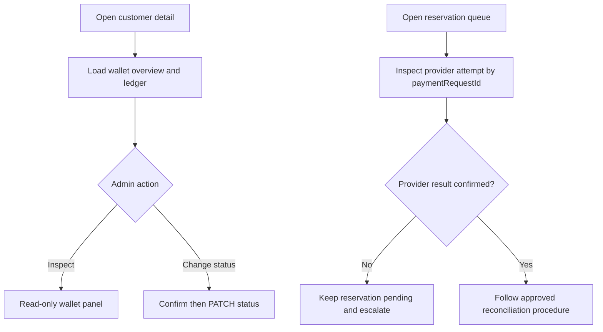

# Admin wallet API integration

Admin routes require the normal admin JWT and the existing `refund_requests.read` or `refund_requests.status` permission. Amounts in wallet overview and ledger records are rupee decimal strings, preserving the existing ledger format.

## Dynamic admin sidebar

The admin menu is returned by the authenticated admin session/menu response and filtered against the active user's permission codes. The Refund Requests group includes **Wallets** at `/refund-requests/wallets`, visible to admins with `refund_requests.read` (super admins with wildcard permissions also see it). Wallet lookup, transaction history, and reservation visibility use that read permission. The status control additionally requires `refund_requests.status`.

The backend supplies the menu item and API routes; the admin frontend must implement the `/refund-requests/wallets` page and render wallet tools according to the caller's permissions. Users without read permission will not receive the Wallets menu item. Hide or disable the status control when the user lacks `refund_requests.status`, and handle a `403` from the API as the authoritative permission result.

## Wallet lookup

`GET /api/admin/wallets/:customerId`

Returns `balance`, `reserved`, `available`, `currency`, and `status`. Customer ID is an admin route parameter; storefront clients must use `GET /api/wallet` instead.

## Transaction history

`GET /api/admin/wallets/:customerId/transactions?page=1&limit=20`

Returns the customer's existing ledger entries newest first with `page`, `limit`, `total`, and `totalPages` pagination metadata.

## Wallet status

`PATCH /api/admin/wallets/:customerId/status` requires `refund_requests.status`.

```json
{ "status": "FROZEN" }
```

Allowed values are `ACTIVE`, `FROZEN`, and `DISABLED`. A non-active wallet cannot be reserved or debited. Status changes do not remove or rewrite ledger history. Status changes are critically audited (`WALLET_STATUS_CHANGED`) with actor and previous/next status; no secrets are stored.

`:customerId` must be a UUID.

## Pending reservation visibility and reconciliation

`GET /api/admin/wallets/reconciliation/pending-reservations?page=1&limit=20` requires `refund_requests.read`. It lists reservations still pending, including their related customer, payment request, and order references where available. Expiry timestamps are informational: a reservation must not be released solely because it has expired while payment status is uncertain.

`POST /api/admin/wallets/reconciliation/release-definitive` requires `refund_requests.status`. Body: `{ "limit": 50 }` (1–200). It releases **only** stale `PENDING` reservations whose linked payment request is already `FAILED`, `CANCELLED`, or `EXPIRED`. It does **not** release holds for `PAYMENT_PENDING` / `LINK_GENERATED` (uncertain) payments, and it never releases after `PAID` (consume wins). Gateway definitive failure, link cancel/expire, modal cancel, and gateway-session creation failure also release in the payment-request flow.

## Deployment state

`WALLET_CHECKOUT_ENABLED` defaults to `false`. Keep it disabled until deployment verification confirms provider settlement and recovery behavior. `GOKWIK_WALLET_REDEMPTION_ENABLED` also defaults to `false`. GoKwik uses a **separate** merchant-hosted apply/remove adapter; live debit/settlement is blocked until the vendor contract is complete.

Wallet foundation migration `1786011000000` and provider enum migration `1786012000000` are intentionally irreversible after deploy. Soft rollback is feature-flag disable plus reservation reconciliation — not `migration:revert`.

## Authentication and response format

All routes use the `/api` prefix and require an admin JWT, an allowed admin role (`SUPER_ADMIN`, `ADMIN`, or `MODERATOR`), and the per-route permission listed below. Send `Authorization: Bearer <admin-jwt>` and `Content-Type: application/json` for mutation requests.

Successful responses use the standard envelope:

```json
{
  "success": true,
  "data": { "balance": "125.50", "reserved": "25.00", "available": "100.50", "currency": "INR", "status": "ACTIVE" },
  "message": "Wallet overview retrieved successfully",
  "timestamp": "2026-10-16T10:00:00.000Z"
}
```

Errors use `{ "success": false, "error": "...", "message": "...", "statusCode": 403, "timestamp": "...", "path": "..." }`; validation `message` can be an array. Use HTTP status for control flow and show the server message as detail.

## Wallet API reference

| Method and route | Permission | Purpose |
|---|---|---|
| `GET /api/admin/wallets/:customerId` | `refund_requests.read` | Get wallet summary for a customer selected in the admin customer/order UI |
| `GET /api/admin/wallets/:customerId/transactions?page=1&limit=20` | `refund_requests.read` | Browse that customer's wallet ledger |
| `PATCH /api/admin/wallets/:customerId/status` | `refund_requests.status` | Set `ACTIVE`, `FROZEN`, or `DISABLED` |
| `GET /api/admin/wallets/reconciliation/pending-reservations?page=1&limit=20` | `refund_requests.read` | Inspect amounts held for checkout attempts |
| `POST /api/admin/wallets/reconciliation/release-definitive` | `refund_requests.status` | Release stale holds only for definitive FAILED/CANCELLED/EXPIRED payment requests |

Pagination is 1-based; `limit` is 1–100 and defaults to 20. Overview uses rupee strings for `balance`, `reserved`, and `available`. Ledger `amount` and `balanceAfter` are legacy rupee strings.

Transaction response `data`:

```json
{
  "items": [
    {
      "id": "<ledger-uuid>", "refId": "<ledger-reference>", "customerId": "<customer-uuid>",
      "direction": "DEBIT", "type": "CHECKOUT_DEBIT", "amount": "25.00", "balanceAfter": "100.50",
      "currency": "INR", "paymentRequestId": "<payment-request-uuid>", "orderId": "<order-uuid>",
      "reservationId": "<reservation-uuid>", "createdAt": "2026-10-16T10:00:00.000Z"
    }
  ],
  "page": 1, "limit": 20, "total": 1, "totalPages": 1
}
```

### Wallet status control

Request:

```http
PATCH /api/admin/wallets/<customer-uuid>/status
```

```json
{ "status": "FROZEN" }
```

Allowed statuses are `ACTIVE`, `FROZEN`, and `DISABLED`. The response `data` is the updated account entity; relevant fields include `customerId`, `availableBalance` (rupee string), `reservedBalancePaise` (integer paise string), `currency`, `status`, and audit timestamps. Status changes do not erase ledger history. A non-active account cannot be newly reserved or debited, but existing reservations remain held.

Example response data:

```json
{
  "id": "<wallet-account-uuid>",
  "refId": "<wallet-reference>",
  "customerId": "<customer-uuid>",
  "availableBalance": "125.50",
  "reservedBalancePaise": "2500",
  "status": "FROZEN",
  "currency": "INR",
  "updatedAt": "2026-10-16T10:00:00.000Z"
}
```

### Pending reservation visibility

`GET /api/admin/wallets/reconciliation/pending-reservations?page=1&limit=20` returns `{ items, page, limit, total, totalPages }`. Each item includes `customerId`, `paymentRequestId`, `orderId`, `amountPaise` (integer paise string), `status`, `idempotencyKey`, `expiresAt`, `settledAt`, and timestamps. The response contains identifiers only; use the payment request ID to inspect the original provider attempt.

This is a visibility endpoint only. **There is no manual release or reconciliation mutation endpoint.** Do not release funds based solely on `expiresAt`; confirm payment state with the original provider and follow the operational reconciliation procedure first.

Example reservation page data:

```json
{
  "items": [
    {
      "id": "<reservation-uuid>",
      "customerId": "<customer-uuid>",
      "paymentRequestId": "<payment-request-uuid>",
      "orderId": null,
      "amountPaise": "2500",
      "status": "PENDING",
      "idempotencyKey": "wallet-checkout:<payment-request-uuid>",
      "expiresAt": "2026-10-16T11:00:00.000Z",
      "settledAt": null,
      "createdAt": "2026-10-16T10:00:00.000Z"
    }
  ],
  "page": 1,
  "limit": 20,
  "total": 1,
  "totalPages": 1
}
```

## Existing refund workflow APIs used by wallet operations

On **approve**, admin chooses the settlement destination for the full approved amount: `WALLET` (default) or `BANK_ACCOUNT`. Wallet means the merchant retains gateway-captured funds and the customer receives in-store wallet credit on **initiate** (no payment-gateway refund call). Bank uses bank details the customer already submitted on the return request. The admin panel must not offer arbitrary wallet credits or debits outside this refund workflow.

| Method and route | Permission | Use |
|---|---|---|
| `GET /api/admin/refund-requests` | `refund_requests.read` | Search/filter refund requests |
| `GET /api/admin/refund-requests/:id` | `refund_requests.read` | Read amount allocation, provider, history, and available actions |
| `POST /api/admin/refund-requests` | `refund_requests.create` | Create a refund request for an order |
| `POST /api/admin/refund-requests/:id/review` | `refund_requests.update` | Move into review |
| `POST /api/admin/refund-requests/:id/approve` | `refund_requests.approve` | Approve; choose `refundDestination` (`WALLET` default / `BANK_ACCOUNT`) |
| `POST /api/admin/refund-requests/:id/reject` | `refund_requests.reject` | Reject with a reason |
| `POST /api/admin/refund-requests/:id/initiate` | `refund_requests.status` | Start settlement from approve-time allocation (wallet credit, bank payout, or legacy gateway leg) |
| `POST /api/admin/refund-requests/:id/reconcile` | `refund_requests.status` | Query provider result without starting another refund |
| `POST /api/admin/refund-requests/:id/retry` | `refund_requests.status` | Retry only after a conclusive failure |
| `GET /api/admin/refund-requests/:id/payout` | `refund_payouts.read` | Read the associated COD/wallet payout record |

Create request:

```json
{ "orderId": "<order-uuid>", "reason": "CUSTOMER_CANCELLATION", "comment": "Customer return approved" }
```

Approve request (wallet is the default when `refundDestination` is omitted):

```json
{ "approvedAmount": "25.00", "refundDestination": "WALLET", "comment": "Approved after review" }
```

Bank destination (requires customer bank details on the linked return):

```json
{ "approvedAmount": "25.00", "refundDestination": "BANK_ACCOUNT", "comment": "Pay out to customer bank" }
```

Refund detail `data` includes `status`, `requestedAmount`, `approvedAmount`, `paymentProvider`, provider identifiers/status, `refundable`, `amountAllocation` (`onlineAmount`, `originalWalletAmount`, `codAmount`, `codRefundMethod`, `adminSettlementDestination`), `codPayout`, `history`, and `availableActions`. Amount fields are INR decimal strings. After approve, allocation shows a zero online (gateway) leg when destination is wallet or bank. Initiate credits wallet or prepares bank payout from that allocation.

Example refund detail fields:

```json
{
  "id": "<refund-uuid>",
  "refId": "<refund-reference>",
  "status": "APPROVED",
  "requestedAmount": "25.00",
  "approvedAmount": "25.00",
  "currency": "INR",
  "paymentProvider": "CASHFREE",
  "providerRefundStatus": null,
  "refundable": {
    "capturedAmount": "100.50",
    "alreadyRefundedAmount": "0.00",
    "pendingRefundAmount": "0.00",
    "refundableAmount": "100.50",
    "currency": "INR",
    "requiresOnlineRefund": true,
    "onlineRefundableAmount": "75.50",
    "codRefundableAmount": "25.00"
  },
  "amountAllocation": {
    "totalAmount": "25.00",
    "onlineAmount": "0.00",
    "originalWalletAmount": "0.00",
    "codAmount": "25.00",
    "onlineProvider": null,
    "codRefundMethod": "WALLET",
    "adminSettlementDestination": "WALLET"
  },
  "codPayout": null,
  "history": [],
  "availableActions": []
}
```

Actual detail responses include additional fields and settlement statuses; the UI should render server-provided values instead of inferring refund state from the order alone.

## Admin panel flow and UI design

### Customer wallet detail

- Add a wallet panel to the existing customer detail view and use the selected customer UUID. Load overview and the first transaction page together.
- Show posted balance, reserved funds, available balance, and status separately. The ledger table should show date, credit/debit, type, amount, balance after, and links to order/refund/payment references.
- Provide Activate, Freeze, and Disable actions behind a confirmation dialog. Explain that the change blocks new spending but does not release pending reservations.
- Paginate from the returned totals. Do not add a top-up, manual credit, manual debit, or balance adjustment form; no audited adjustment API is implemented.

### Reservation queue

- Add a read-only table showing created time, customer ID, payment request ID, order ID, amount (convert paise to rupees for display), status, expiry, and age.
- Link to existing records where available. Use the payment request ID to investigate the provider attempt. Do not auto-release solely because `expiresAt` passed while payment is still pending. Use `POST .../release-definitive` only after the payment request is confirmed failed/cancelled/expired (or rely on the automated payment-path release).

### Refund workflow

- On approve, let Finance choose `refundDestination`: **Wallet** (default) or **Bank account**. Wallet keeps captured payment with the merchant and credits the customer wallet on initiate. Bank uses customer-submitted return bank details.
- Show amount allocation and payout state on refund detail after approve (`adminSettlementDestination`, `codRefundMethod`, `codPayout`).
- Enable Initiate only when `availableActions` permits it. For uncertain gateway outcomes (legacy/online legs) show Reconcile and hide Retry. Show Retry only after a conclusive failure and when the API allows it.
- Orders that originally paid with wallet tender still settle through the approve-time destination for the approved amount.



## API boundaries and rollout

- No admin wallet top-up, manual debit, or balance-adjustment endpoint is implemented.
- Reservation release for definitive unsuccessful payments is automated; ops may run `release-definitive` for stale leftovers. Do not release uncertain payments.
- GoKwik wallet redemption is a separate adapter (`POST /api/gokwik/apply-wallet-credit`, `POST /api/gokwik/remove-wallet-credit`). Keep `GOKWIK_WALLET_REDEMPTION_ENABLED=false` until settlement contract questions are closed. See `docs/gokwik-wallet-contract-status.md` and `docs/gokwik-wallet-staging-checklist.md`. Provisional apply planning is unit-tested only; live reserve/debit stays blocked.
- `WALLET_CHECKOUT_ENABLED` defaults to `false`. Complete staging verification of payment settlement, recovery, and refund safeguards before enabling production checkout.

## Frontend implementation guide

### Page structure and navigation

The authenticated admin menu payload includes **Refund Requests → Wallets** (`/refund-requests/wallets`) for users with `refund_requests.read`. Implement this route in the admin frontend. The backend repository does not contain the admin page component.

Recommended page layout:

- **Customer wallet** panel: open from an existing customer or order detail view, where the selected customer UUID is already known. Show balance, reserved amount, available amount, wallet status, and a paginated ledger.
- **Pending reservations** tab or page: a read-only queue for payment operations. Each row should link to the related customer/order/payment attempt through existing admin pages when those pages are available.
- Keep refund review and payout actions in the existing refund workflow. Do not add a manual wallet credit, debit, top-up, or reservation-release control; no such wallet endpoint exists.

The wallet API has no customer search/list endpoint. Do not build a customer lookup by guessing wallet routes. Start from the admin's existing customer/order search and pass the selected customer's ID to the wallet detail API.

### API client and permission checks

Use the admin application's shared HTTP client and bearer-token handling. Include `Authorization: Bearer <admin-jwt>` and JSON content type for `PATCH`. The response envelope is `{ success, data, message, timestamp }`; handle non-2xx responses through the shared error handler.

Gate the menu and wallet page on `refund_requests.read`. Gate the status control on `refund_requests.status`; the backend's `403` response remains authoritative. Existing menu filtering already removes the Wallets item when the user lacks read permission. Do not infer permission from role name alone.

Suggested page load sequence:

1. Customer wallet route receives a selected customer ID from existing admin navigation.
2. Fetch `GET /api/admin/wallets/:customerId` and `GET /api/admin/wallets/:customerId/transactions?page=1&limit=20` in parallel.
3. Render the summary and ledger only after their respective responses resolve; provide independent retry states.
4. Load the reservation queue separately using `GET /api/admin/wallets/reconciliation/pending-reservations?page=1&limit=20` so a queue failure does not block customer detail.
5. After a successful status update, use the returned account data and refetch the overview. Do not optimistically claim a status change before the API succeeds.

### Customer wallet panel

Display `balance`, `reserved`, and `available` as INR decimal strings, clearly labeling `available` as spendable. The ledger's `amount` and `balanceAfter` are also rupee strings. Show direction, entry type, date, and associated order/refund/payment references when present. Paginate from `page`, `limit`, `total`, and `totalPages` returned by the API.

Status update request:

```http
PATCH /api/admin/wallets/<customer-uuid>/status
Authorization: Bearer <admin-jwt>
Content-Type: application/json
```

```json
{ "status": "FROZEN" }
```

Offer only `ACTIVE`, `FROZEN`, and `DISABLED`, and require a confirmation step. Explain before confirmation that a non-active account cannot be newly reserved or debited, existing reservations remain held, and ledger history is retained. Refresh the customer summary after the mutation. The updated account response's `availableBalance` is in rupees; `reservedBalancePaise` is integer paise as a string.

### Reservation queue

Render `amountPaise` as a display amount by formatting the integer paise string (100 paise = INR 1); do not use it as a rupee value or add it directly to rupee columns. Show reservation ID, customer ID, payment request ID, order ID, status, creation time, expiry time, and settled time. The endpoint is visibility-only: it does not offer a release or reconcile action.

An expired timestamp is not proof of payment failure. Keep a pending reservation in an attention-needed state until the original payment attempt is verified using the existing provider/payment request tools and the operational reconciliation process. Do not trigger a retry or release from this page.

### Refund screen behavior

Use the existing refund APIs and state machine. On approve, offer `refundDestination` Wallet (default) or Bank account. Display the server's post-approve `amountAllocation` (`adminSettlementDestination`), payout details, and `availableActions`. Only show initiate/reconcile/retry controls when allowed by `availableActions` and existing permissions. For uncertain gateway results on any remaining online leg, offer reconciliation rather than another initiate/retry action.

### UI states and frontend acceptance checks

- Provide loading, empty, retryable-error, and permission-denied states for each panel/table.
- Treat `401` as an expired admin session, `403` as missing permission, `404` as an unknown customer/resource, and `400` as validation/business rejection. Render the backend message as context, not as a stable machine code.
- Refresh wallet data after status changes and after investigating a completed checkout/refund; do not locally edit ledger history or calculate a new balance from a page of transactions.
- Confirm a user with read permission sees lookup/history/queue, while a user with status permission can change status only if they also can access the read-gated wallet page.
- Confirm the page has no top-up, manual adjustment, reservation release, or arbitrary refund destination action.
