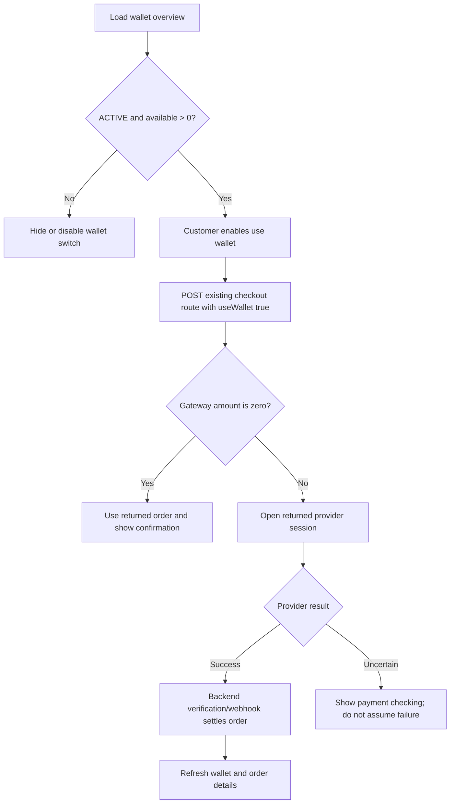

# Customer wallet API integration

These routes use the existing Cureka customer session. Send the authenticated session cookie and the normal JSON headers. The wallet is bound to the session customer; requests do not accept a customer ID.

Wallet checkout is disabled by default. Operators must set `WALLET_CHECKOUT_ENABLED=true` only after the payment and reconciliation safeguards are deployed and verified. GoKwik wallet redemption is not available in this phase.

## Wallet overview

`GET /api/wallet`

Returns rupee amounts as decimal strings. `balance` is the posted ledger balance; `reserved` is held for unsettled checkout attempts; `available` is balance minus reservations.

```json
{
  "balance": "125.50",
  "reserved": "25.00",
  "available": "100.50",
  "currency": "INR",
  "status": "ACTIVE"
}
```

## Transaction history

`GET /api/wallet/transactions?page=1&limit=20`

`page` starts at 1; `limit` is 1–100. Results are ordered newest first. Ledger `amount` and `balanceAfter` remain rupee strings to match historical records and existing APIs.

```json
{
  "items": [
    {
      "direction": "CREDIT",
      "type": "COD_REFUND",
      "amount": "125.50",
      "balanceAfter": "125.50",
      "currency": "INR",
      "payoutId": "…",
      "refundRequestId": "…",
      "createdAt": "2026-10-16T10:00:00.000Z"
    }
  ],
  "page": 1,
  "limit": 20,
  "total": 1,
  "totalPages": 1
}
```

## Checkout

Use the existing checkout route and add `useWallet: true` to request the maximum wallet amount the server can apply. The server prices the current cart and selects the amount; clients must not submit a wallet amount.

`POST /api/payment-requests/checkout` or `POST /api/payment-requests/checkout/modal`

```json
{
  "addressId": "<address UUID>",
  "paymentMethod": "CASHFREE",
  "useWallet": true,
  "orderSource": "WEBSITE"
}
```

For a partial wallet payment, the existing provider session charges only the remaining amount. `paymentData.walletAmount`, `paymentData.gatewayAmount`, and `paymentData.eligibleTotal` are rupees; their sum is checked by the server. For a full wallet payment the server creates and settles the order without creating a gateway session, and returns the existing order response.

Example partial-payment response fields (the normal checkout response envelope and provider fields are retained):

```json
{
  "gateway": "cashfree",
  "paymentData": {
    "paymentRequestId": "<payment request UUID>",
    "refId": "<payment request reference>",
    "amount": 75.5,
    "totalAmount": "75.50",
    "walletAmount": "25.00",
    "gatewayAmount": "75.50",
    "eligibleTotal": "100.50",
    "paymentSessionId": "<provider session>"
  }
}
```

`useWallet` with COD is rejected. Wallet checkout is also rejected when the feature flag is off or the selected checkout provider is GoKwik/Shiprocket. Omit `useWallet` to retain existing checkout behavior.

Modal cancel, definitive provider failure, payment-link cancel/expire, and gateway-session creation failure release the associated wallet reservation. Cashfree `PAYMENT_USER_DROPPED` is treated as uncertain and does **not** auto-fail or release funds. Provider capture amount is checked against the expected gateway remaining amount before settlement.

Internal accounting converts rupees to integer paise at the wallet domain boundary using decimal parsing and half-up rounding. Historical `available_balance`, ledger `amount`, and `balance_after` columns remain rupees; the paise allocation fields are separate.

## Authentication, headers, and response wrapper

All endpoints below use the `/api` global prefix. Customer endpoints require the same verified customer session cookie used by the storefront. Send `Content-Type: application/json`; send cookies with credentials enabled for cross-origin storefront requests. `Authorization: Bearer` may be shown by Swagger, but the customer guard authenticates the session cookie.

Successful JSON APIs use this common envelope. The examples in the sections above show the `data` value only:

```json
{
  "success": true,
  "data": { "balance": "125.50", "reserved": "25.00", "available": "100.50", "currency": "INR", "status": "ACTIVE" },
  "message": "Wallet overview retrieved successfully",
  "timestamp": "2026-10-16T10:00:00.000Z"
}
```

Errors use the backend error shape, for example:

```json
{
  "success": false,
  "error": "Bad Request",
  "message": "Cureka Wallet checkout is not enabled",
  "statusCode": 400,
  "timestamp": "2026-10-16T10:00:00.000Z",
  "path": "/api/payment-requests/checkout"
}
```

Validation failures may return an array in `message`. Use the HTTP status and `message`; do not depend on error text as a stable machine code unless a `code` property is present.

## API reference and response data

| Method and route | Purpose | Authentication |
|---|---|---|
| `GET /api/wallet` | Current customer's balance and spendable amount | Verified customer session |
| `GET /api/wallet/transactions?page=1&limit=20` | Current customer's posted ledger page | Verified customer session |
| `POST /api/orders/checkout` | Existing authoritative cart/pricing preview (does not start payment) | Verified customer session |
| `POST /api/payment-requests/checkout` | Existing payment-link/session flow; optionally request wallet use | Verified customer session |
| `POST /api/payment-requests/checkout/modal` | Existing SDK modal flow; optionally request wallet use | Verified customer session |
| `POST /api/payment-requests/checkout/modal/verify` | Server-side native provider verification | Verified customer session |
| `POST /api/payment-requests/checkout/modal/cancel` | Mark a dismissed modal attempt cancelled | Verified customer session |
| `GET /api/orders` / `GET /api/orders/:id` | Read order status and payment allocation | Verified customer session; own orders only |
| `GET /api/returns/eligibility/:orderId` | Check return eligibility before showing return action | Verified customer session; own order only |
| `POST /api/returns` | Submit the existing return/refund request workflow | Verified customer session |
| `POST /api/returns/:id/bank-details` | Select/update the permitted COD refund destination | Verified customer session; own return only |

`GET /api/wallet/transactions` returns `{ items, page, limit, total, totalPages }`. Each item is the existing ledger entity: `id`, `refId`, `customerId`, `direction` (`CREDIT`/`DEBIT`), `type` (`COD_REFUND`, `ORIGINAL_WALLET_REFUND`, `CHECKOUT_DEBIT`), rupee-string `amount` and `balanceAfter`, `currency`, business references (`payoutId`, `refundRequestId`, `returnRequestId`, `paymentRequestId`, `orderId`, `reservationId`) and timestamps. Nullable references are `null` when not applicable. Do not use `balanceAfter` as the live available amount; call `GET /api/wallet` for that.

For partial checkout the `paymentData` fields `walletAmount`, `gatewayAmount`, and `eligibleTotal` are rupee decimal strings. `amount` is the provider SDK amount as a number, and `totalAmount` is the gateway amount as a rupee string. A Cashfree example, wrapped as returned by the API:

```json
{
  "success": true,
  "data": {
    "gateway": "cashfree",
    "paymentData": {
      "paymentRequestId": "<payment-request-uuid>",
      "refId": "<payment-request-reference>",
      "paymentSessionId": "<cashfree-session>",
      "cfOrderId": "<cashfree-order-id>",
      "amount": 75.5,
      "totalAmount": "75.50",
      "walletAmount": "25.00",
      "gatewayAmount": "75.50",
      "eligibleTotal": "100.50",
      "prepaidDiscount": "0.00"
    }
  },
  "message": "Checkout session created successfully",
  "timestamp": "2026-10-16T10:00:00.000Z"
}
```

The active gateway remains selected by backend configuration. The client must open the returned Cashfree session or Razorpay link/order using the existing provider integration; it must never initialize a second payment for the wallet share. `Idempotency-Key` is optional on both checkout routes and on modal verification; reuse the same key when retrying the same client operation.

### Verify and cancel a modal payment

For Razorpay, post the provider values to `POST /api/payment-requests/checkout/modal/verify`:

```json
{
  "razorpay_order_id": "<razorpay-order-id>",
  "razorpay_payment_id": "<razorpay-payment-id>",
  "razorpay_signature": "<razorpay-signature>"
}
```

For Cashfree, post the provider order ID and optionally its payment ID:

```json
{ "cf_order_id": "<cashfree-order-id>", "cf_payment_id": "<cashfree-payment-id>" }
```

The backend verifies payment with the provider before finalizing the order. A successful response's `data` is `{ "paymentRequestId": "<uuid>", "refId": "<reference>", "totalAmount": "75.50" }`; `totalAmount` is the gateway-paid part. Webhooks remain authoritative too. Do not show payment failure or restore reserved funds because a client request timed out.

When the customer closes the modal, call `POST /api/payment-requests/checkout/modal/cancel` with:

```json
{ "paymentRequestId": "<payment-request-uuid>" }
```

Its `data` is `{ "paymentRequestId": "<uuid>", "status": "CANCELLED" }`. Cancellation is not proof that the provider did not capture payment. Keep the UI in a pending/recheck state if verification is inconclusive; reservations must not be treated as spendable just because the local modal was dismissed or the reservation expiry time passed.

### Order details and payment breakdown

Read `GET /api/orders/:id` after successful settlement. The standard envelope's `data` contains the normal order response. Legacy rupee amounts and `paymentSummary` are retained. The new allocation fields on the order are integer paise strings:

```json
{
  "success": true,
  "data": {
    "id": "<order-uuid>",
    "grandTotal": "100.50",
    "paymentMethod": "CASHFREE",
    "paymentStatus": "PAID",
    "walletAmountPaise": "2500",
    "gatewayAmountPaise": "7550",
    "paymentSummary": {
      "grandTotal": 100.5,
      "paidAmount": 100.5,
      "paymentMethod": "CASHFREE",
      "paymentStatus": "PAID"
    }
  },
  "message": "Order fetched successfully",
  "timestamp": "2026-10-16T10:00:00.000Z"
}
```

Convert paise fields by dividing by 100 for display. Do not sum rupee and paise fields. For a full-wallet order, `paymentMethod` is `WALLET`, wallet paise equals the eligible order total, and gateway paise is zero.

## Storefront screen and interaction flow

1. On the wallet screen, load overview first, then fetch transactions. Render `available` as the spendable amount; render reserved funds separately. Show a loading skeleton, an empty transaction state, and retry on network failure. Do not offer top-up or manual debit controls; no such customer API exists.
2. At checkout, show a wallet-use switch only when the overview is `ACTIVE` and `available` is positive. The switch submits `useWallet: true`; never send a client-calculated amount. The backend can apply less than the shown balance after authoritative cart pricing.
3. After the checkout response, display the exact server breakdown: wallet contribution, gateway remainder, and eligible total. If gateway remainder is positive, launch the returned provider session. If zero, the returned data is the created order; navigate to its confirmation state without opening a gateway.
4. On gateway success, use the existing verified payment flow and then refresh wallet overview and order detail. On a timeout, show “checking payment” and retain the checkout context. On confirmed failure/cancel, only show the final state after the backend/provider has resolved it.
5. Use the order's `walletAmountPaise` and `gatewayAmountPaise` to explain the settled split in order history/detail.



## Refund destination limits in this phase

The customer return flow may still collect a preferred COD destination and bank details. Final settlement destination is chosen by admin on refund **approve** (`WALLET` default or `BANK_ACCOUNT` using those bank details). This customer API does not redirect gateway funds itself. COD destination choices on the return are controlled by `RETURN_WALLET_REFUND_ENABLED` (default `false`):

```http
POST /api/returns/<return-id>/bank-details
Content-Type: application/json
```

Wallet destination:

```json
{ "refundMethod": "WALLET" }
```

Bank destination:

```json
{
  "refundMethod": "BANK_ACCOUNT",
  "bankDetails": {
    "accountHolderName": "Test Customer",
    "accountNumber": "1234567890",
    "confirmAccountNumber": "1234567890",
    "ifsc": "ABCD0123456",
    "bankName": "Example Bank"
  }
}
```

`data` is the updated customer return detail, including `codRefund.method`, `payoutStatus`, masked `bankDetails`, `customerMessage`, and `canUpdateBankDetails`. This endpoint only updates a return that belongs to the logged-in customer and is still editable. The return request must be for a REFUND resolution and an order with a COD portion. If the feature flag is off, requesting `WALLET` returns an error; do not display it as available based solely on a locally configured UI flag. There is no standalone wallet-refund request endpoint.

## Refund destinations for wallet-funded orders

- **Full wallet payment:** refunds restore money to the customer wallet as `ORIGINAL_WALLET_REFUND` (not a gateway refund).
- **Partial wallet + Razorpay/Cashfree:** the wallet tender returns to the wallet; only the gateway remaining amount is refunded through the original provider. Splits use persisted `walletAmountPaise` / `gatewayAmountPaise`.
- **COD → wallet:** unchanged — permitted COD refund portions may still credit the wallet as `COD_REFUND` when policy/flags allow.

## GoKwik (separate integration)

Native `useWallet` on GoKwik checkout remains rejected. GoKwik Custom Wallet is a distinct merchant-hosted contract:

| Endpoint | Direction | Purpose |
|---|---|---|
| `POST /api/gokwik/apply-wallet-credit` | GoKwik → Cureka | Apply wallet credit to a cart |
| `POST /api/gokwik/remove-wallet-credit` | GoKwik → Cureka | Remove previously applied credit |

Keep `GOKWIK_WALLET_REDEMPTION_ENABLED=false`. When disabled, these endpoints reject application (`GOKWIK_WALLET_DISABLED`). When enabled without a completed settlement contract, they still refuse live mutation (`GOKWIK_WALLET_CONTRACT_INCOMPLETE`). Speculative settle/consume is separately blocked (`GOKWIK_WALLET_SETTLEMENT_BLOCKED`). Cart mapper continues to report `wallet_credit_used: 0` for ordinary GoKwik checkout. Provisional planning helpers exist in code for tests only — they do not move funds.

Eight-question register (policy / evidence / provisional assumption / confirmation required): `docs/gokwik-wallet-contract-status.md`. Staging checklist: `docs/gokwik-wallet-staging-checklist.md`.

## UI error handling

- `401`: refresh/re-authenticate the customer session.
- `400`: show the API validation/business message, such as wallet checkout disabled or COD not supported.
- `403`/`404`: return/order is unavailable to this customer; do not retry using another user's ID.
- `409`: wallet balance/status/reservation conflict; refresh overview and cart pricing, then ask the customer to retry checkout.
- Network timeout: query/verify through the existing payment flow; never assume provider failure from timeout alone.

Customer ownership is always derived from the session. Never add `customerId` to customer wallet query parameters or request bodies.

### Pricing preview before checkout

`POST /api/orders/checkout` accepts the existing `CheckoutDto`; use `addressId`, optional `paymentMethod` (`RAZORPAY` or `CASHFREE` for prepaid pricing), and optional `orderSource`. This endpoint returns the standard success envelope with the existing cart summary and does not reserve wallet funds or create a payment attempt. Treat it as a display preview only: the cart can change, so the `paymentData` breakdown from the subsequent checkout call is authoritative.

### Return destination response

After `POST /api/returns/:id/bank-details`, the returned success envelope has customer return detail in `data`. The wallet-specific part is shaped like:

```json
{
  "success": true,
  "data": {
    "id": "<return-uuid>",
    "returnNumber": "<return-number>",
    "resolution": "REFUND",
    "estimatedRefundAmount": "25.00",
    "approvedRefundAmount": null,
    "codRefund": {
      "method": "WALLET",
      "payoutStatus": null,
      "bankDetails": null,
      "customerMessage": "Your refund request has been initiated. It may take 5–7 working days after approval.",
      "canUpdateBankDetails": true
    }
  },
  "message": "Refund destination updated",
  "timestamp": "2026-10-16T10:00:00.000Z"
}
```

The return may later be converted by operations into the existing refund request workflow. Do not show the wallet balance as credited until `GET /api/wallet` reflects the ledger credit.

## Frontend implementation checklist

### Where to integrate

- Add a **Wallet** entry to the signed-in customer's account navigation. Use the authenticated customer ID only for display context; wallet requests never send it.
- On the wallet page, show available balance as the spendable figure, and show posted balance and reserved funds separately. Add transaction history below it with direction, date, type, amount, and relevant order/refund reference links.
- Add a wallet-use switch to the existing checkout payment step. Render it only when the wallet overview is `ACTIVE` and `available` is greater than zero. Keep the existing COD and gateway options intact. Do not show the switch for GoKwik checkout.

### API client behavior

Use the storefront's shared authenticated API client so session cookies, base URL, response envelope handling, and re-authentication behavior stay consistent. For cross-origin requests, the browser request must include credentials. Do not persist a wallet balance as authoritative state; refetch after checkout settlement and when returning to the wallet page.

Example browser request using `fetch`:

```ts
const response = await fetch(`${API_BASE_URL}/api/wallet`, {
  method: 'GET',
  credentials: 'include',
  headers: { Accept: 'application/json' },
});
const result = await response.json();
if (!response.ok || !result.success) throw new Error(result.message ?? 'Wallet request failed');
const wallet = result.data;
```

Load the ledger with `GET /api/wallet/transactions?page=1&limit=20`; use `totalPages` to enable/disable pagination controls. Treat overview fields as INR decimal strings. The paise allocation values in order details are integer strings; format them for display without mixing them into rupee arithmetic.

### Checkout interaction

1. Load wallet overview when the payment step opens. If it fails, keep regular checkout available and hide/disable wallet use with a retry affordance.
2. When enabled, submit `useWallet: true` on the existing checkout endpoint. Do not submit a requested wallet amount or subtract the balance in the browser. Keep the same idempotency key when retrying the same request.
3. Use the returned `walletAmount`, `gatewayAmount`, and `eligibleTotal` as the authoritative breakdown. Show these values before opening the gateway flow when possible.
4. If `gatewayAmount` is greater than zero, launch only the provider session returned by checkout, using the existing Razorpay/Cashfree integration. If it is zero, follow the full-wallet order response and confirmation route; do not launch a provider SDK.
5. On client timeout, show a pending/checking state and retain the payment request ID. Continue through the existing verification/status flow or wait for its callback; a timeout is not a failed payment. After a confirmed result, reload order detail and wallet overview.
6. If checkout returns an error, keep the cart and selection available for correction. For a conflict, refresh wallet overview and authoritative cart pricing before retrying.

Use the existing order confirmation and payment recovery behavior. Do not add a separate wallet payment state machine or infer settlement from the SDK's client callback alone.

### Screen state and accessibility

- Wallet overview: loading skeleton, loaded balance, empty-wallet state, unavailable/error state with retry.
- Ledger: loading rows, empty history, paginated rows, and recoverable error state. Label credits and debits in text as well as color.
- Checkout: unchecked by default unless the existing product design specifies otherwise; clearly show the amount the server applied after checkout returns. Disable repeated submits while one checkout request is in flight.
- Account status other than `ACTIVE`, zero available balance, disabled feature flag, or unsupported provider: do not offer wallet use. The server remains authoritative and may reject a stale UI state.
- Refund destination: show **Wallet** only when the backend response allows the return destination flow and the COD refund policy permits it. This option applies only to the COD portion. Do not advertise a gateway refund-to-wallet option.

### Frontend acceptance checks

- Customer can view only their own wallet; no customer ID is sent to wallet endpoints.
- Checkout without `useWallet` behaves as before. COD remains selectable without wallet use.
- Wallet switch submits a boolean only; payment breakdown comes from the response.
- Partial wallet checkout launches the existing provider for the gateway remainder only; full wallet checkout does not launch it.
- Timeout or modal dismissal never displays a definitive failure until backend/provider status is conclusive.
- After settlement, order detail and wallet overview show the same completed allocation and updated spendable balance.
