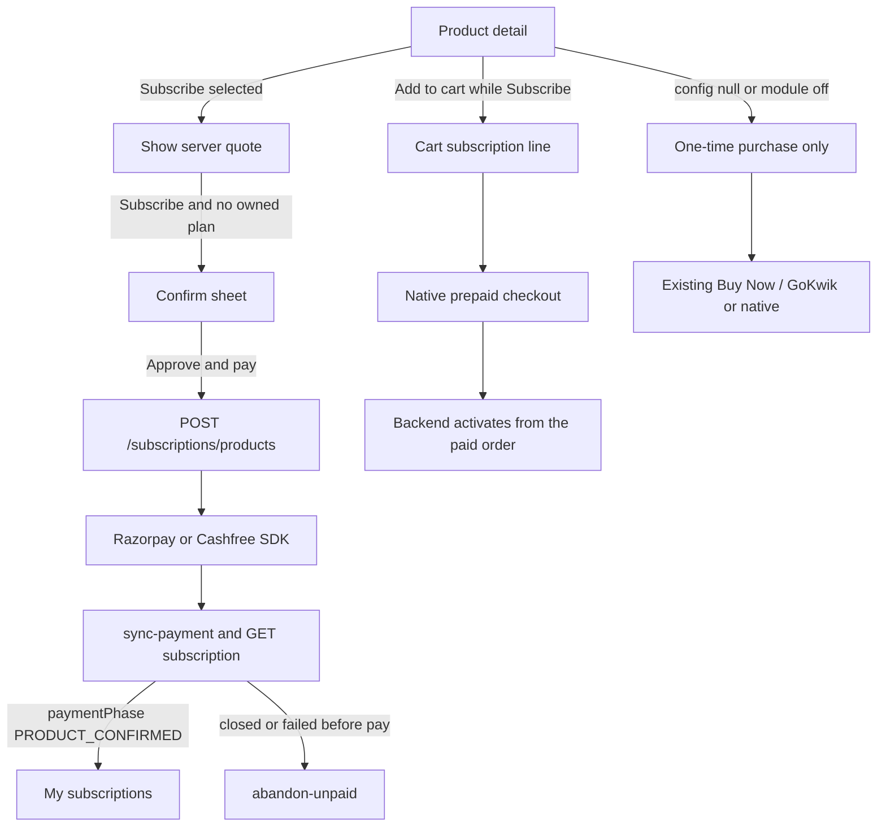
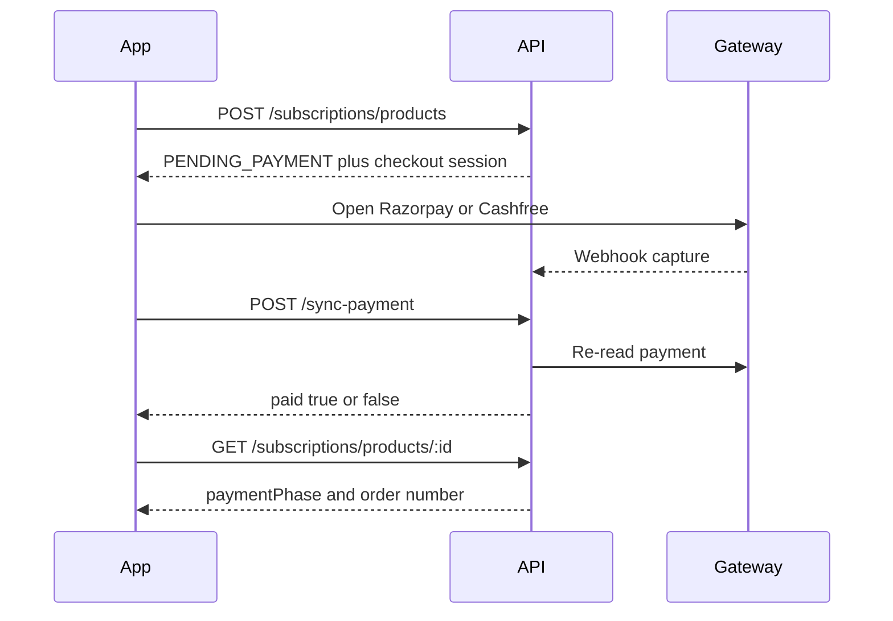

# Product Subscription — Mobile App Integration

Use this guide so the **mobile product-subscription module** follows the current Cureka website. The website code and the customer APIs below are the source of truth. Do not invent endpoints, prices, or payment success.

Related, and still in force for one-time purchases:

- `docs/pdp-buy-now-mobile-app-integration.md`
- `docs/wallet-mobile-app-integration.md`

Membership is a different product. Do not implement membership from this guide.

Base path: `/api/v1`.

---

## 1. What the website actually does

There are two ways a customer starts a product subscription. They are not interchangeable.

| Path | When the website uses it | Checkout | When the subscription becomes active |
|---|---|---|---|
| **PDP Subscribe** | Customer selects Subscribe on the product page and taps Subscribe | Direct Razorpay or Cashfree session from `POST /subscriptions/products`. **Not** the cart and **not** GoKwik. | After the product payment is captured and the backend creates the order. AutoPay on is not enough. |
| **Cart line** | Customer taps Add to cart while Subscribe is selected, then checks out from the cart | Native prepaid checkout (Razorpay / Cashfree). GoKwik is refused for any cart that contains a subscription line. | After that order is paid, the **backend** calls subscription activation. The app does not charge again. |

One-time Buy Now stays on the existing Buy Now guide: GoKwik when the public checkout provider is GoKwik, otherwise native prepaid. Subscribe never opens GoKwik.

Pricing on the PDP confirm sheet is **merchandise only**: variant selling price, quantity, subscription discount, then membership discount when the customer is logged in. Shipping, handling, platform fee, coupons, and the prepaid-percent discount are not added to that amount.

---

## 2. Rules the app must keep

1. Show Subscribe only when the subscriptions module is on for the app **and** `GET /subscriptions/products/config` returns an enabled config with at least one frequency.
2. Display only the frequencies that config returns. `BI_MONTHLY` means **every 2 months**, never twice a month. Do not hard-code test intervals (`MINUTES_2`, `MINUTES_5`, `HOURS_27`, `HOURS_48`, `HOURS_72`, and the other short tenures). Those appear only when the backend has test tenures enabled.
3. Never calculate the charge on the device. Show `finalAmount` from the quote, then charge the amount the create response returns.
4. One owned subscription per product variant. Owned means `ACTIVE`, `RENEWAL_PAYMENT_PENDING`, `PAST_DUE`, or `PAUSED`. The button becomes **Manage subscription** and opens that plan.
5. `PENDING_PAYMENT` is not a subscription the customer owns. If the customer leaves checkout before payment, call abandon for that row. Do not abandon a Cashfree checkout that is still open.
6. A gateway redirect, SDK “success”, or AutoPay-on flag is not proof of payment. Confirm with `POST /subscriptions/products/:id/sync-payment` and `GET /subscriptions/products/:id`.
7. Razorpay **card** registers the mandate with ₹1. That ₹1 is not the product payment. The order appears only after the product debit is captured. Razorpay **UPI** and Cashfree card/UPI charge the product amount during authorization.
8. Cancel stops future renewals. It does not refund a payment that was already captured. Orders already placed stay valid.
9. Pause, skip, frequency, address, and quantity changes are refused inside the change-cutoff window and while the current cycle is already billing. Use `allowedActions` from the subscription payload. Do not enable a button the payload marks false.
10. Coupons are hidden on the website whenever the cart contains a subscription line. Match that. The PDP subscribe confirm sheet has no coupon field.
11. On logout, drop subscription lists, mandate checkout payloads, and payment session ids.

---

## 3. Auth, envelope, and feature flags

Customer mutations use the same **verified** customer session the app already uses for cart and orders. The website sends the session cookie. The app should send that same credential (`Authorization: Bearer <customer_session>` when that is how the app authenticates). Guest and unverified users can read public config and the guest quote. They cannot create or manage a subscription. If Subscribe is tapped while logged out, open sign-in and resume Subscribe after verification. Do not fall through to one-time Buy Now.

Success:

```json
{
  "success": true,
  "data": {},
  "message": "…",
  "timestamp": "…"
}
```

Error:

```json
{
  "success": false,
  "statusCode": 400,
  "error": "Bad Request",
  "message": "You already have a subscription for this product option",
  "code": "SUBSCRIPTION_CHANGE_CUTOFF",
  "timestamp": "…",
  "path": "/api/v1/subscriptions/products/…"
}
```

`code` is present only for the subscription errors in section 12. Other failures have `message` only. Branch on `code` when it is there, otherwise show `message`.

If `SUBSCRIPTIONS_MODULE_ENABLED` is not true on the API, every `/subscriptions/products` route returns **404**. Hide the module. The website also requires its own build flag `NEXT_PUBLIC_SUBSCRIPTIONS_ENABLED=true`. The app needs the equivalent remote or build flag, and must still treat a 404 or a null config as “subscribe unavailable”.

---

## 4. Screen flow



### 4.1 Product detail

Load config when the selected variant changes:

```http
GET /subscriptions/products/config?productId={uuid}&productVariantId={uuid}
```

No auth. `data: null` means hide Subscribe and keep one-time purchase only.

When the customer is logged in, also load their plans (`GET /subscriptions/products`) and match `productId` + `productVariantId`.

| State | Purchase options | Primary button |
|---|---|---|
| Config null | One-time only | Buy Now |
| Config enabled, purchase type One-time | One-time price and MRP | Buy Now, then the existing one-time checkout |
| Subscribe, no owned plan | Server quote and frequency picker | Subscribe |
| Subscribe, owned plan | Banner: “You are subscribed to this option”, frequency, quantity, status | Manage subscription |

Frequency picker labels come from `intervalLabels[].label`. Default to the first allowed frequency. Changing variant, quantity, or frequency reloads the quote.

Quote for a guest:

```http
GET /subscriptions/products/quote?productId={uuid}&productVariantId={uuid}&quantity=1&frequency=MONTHLY
```

Quote for a verified customer (includes membership discount when one applies):

```http
GET /subscriptions/products/quote/me?productId={uuid}&productVariantId={uuid}&quantity=1&frequency=MONTHLY
```

Show, in this order:

- Product price: `subscriptionPrice` (unit selling price times quantity, before discount)
- Subscription discount: `discountAmount`, only when greater than 0
- Shipping and other cart charges: **₹0** on this sheet
- Pay now: `finalAmount`

If `memberDiscountApplied` is true, the membership discount is already inside `finalAmount`. Do not subtract it again.

Add to cart while Subscribe is selected sends a subscription line (section 8). It does not start payment. Subscribe opens the confirm sheet and does not require the line to be in the cart. If a subscription line for this variant is already in the cart, the confirm sheet uses that quantity. Otherwise quantity is 1.

Out of stock disables Add to cart. Subscribe still requires a frequency. The website does not block Subscribe on the same stock flag as Add to cart; the create API still rejects an unpublished product or inactive variant.

### 4.2 Confirm sheet

Title: **Confirm subscription**. Body: product name, interval label, quantity, the price rows above.

When `firstPayment.isMandateAuthorization` is true, show an AutoPay method choice. Default **UPI**.

| Method | Copy the website shows |
|---|---|
| `card` | “Card verification registers AutoPay and may charge ₹1. That registration is separate from your subscription amount, which is confirmed only after the product payment succeeds.” |
| `upi` | Approving turns on UPI AutoPay. This payment also pays for the product. Later renewals debit automatically, up to the mandate limit. |
| `emandate` | Razorpay registers the bank account. The bank screen can show ₹0. The subscription amount is then debited. Later renewals debit that account. |

When `isMandateAuthorization` is false, hide the method picker and say this payment is only for this product, the subscription starts after payment succeeds, and it does not start AutoPay.

Buttons: **Cancel** (closes the sheet, no API call) and **Approve and pay** (disabled while the quote is loading or payment is opening).

Address: use the customer’s selected delivery address, otherwise the default, otherwise the first saved address (`GET /users/addresses`, the same address book the app already uses). If none exists, close the sheet and send the customer to add an address. Do not create the subscription.

### 4.3 Payment and result

After Approve and pay, call create (section 6.4), open the gateway from that response, then confirm on the server (section 7). Land on **My subscriptions**. Do not show a local “order placed” screen from the SDK result alone.

### 4.4 My subscriptions

```http
GET /subscriptions/products?page=1&limit=20
```

`data` is `{ items, meta: { page, limit, total, totalPages } }`. Empty `items` shows “No subscriptions yet” and a shop CTA.

Each card shows product image and name, status, interval label, quantity, next charge, next delivery, and AutoPay:

| `autopayReady` | Status | Label |
|---|---|---|
| true | not cancelled or expired | AutoPay on |
| false | cancelled or expired | AutoPay cancelled |
| false | otherwise, and setup is allowed | AutoPay off. Renewals use a payment link until AutoPay is set up. |

Cancelled and expired plans use a red status badge. Do not show “Payment processing” on those plans. Next charge and next delivery read **Cancelled**.

List actions, only when `allowedActions` says so:

- **Pay now** when a payment is still due (`retryPayment` and a payable cycle or pending payment)
- **Pause Plan**
- **Resume**
- **Cancel Plan**
- **Details**

Pause asks for confirmation. Cancel confirms with: “Your subscription will stop. Orders already placed are unchanged.” An optional reason may be sent; the website sends it when the customer types one.

### 4.5 Subscription detail

Load together:

- `GET /subscriptions/products/:id` (this also asks the server to settle a payment it can already see)
- `GET /subscriptions/products/:id/payments`
- `GET /subscriptions/products/:id/cycles`
- `GET /subscriptions/products/:id/history`
- `GET /subscriptions/products/:id/mandate`

While status is `PENDING_PAYMENT`, `RENEWAL_PAYMENT_PENDING`, or `PAST_DUE`, refresh the detail about every 8 seconds. Stop when the status leaves those values.

Show the payment notice from section 7.5. Offer **Check status**, which reloads the detail. Do not offer Pay again while `paymentPhase` is `RECONCILING` or `PRODUCT_PROCESSING`.

Detail actions the website shows, gated by `allowedActions`:

- Change frequency, limited to `config.frequencies` on the subscription
- Change address, using the address book
- Set up AutoPay, only when `setupMandate` is true and `autopayReady` is false
- Refresh AutoPay status
- Pay a cycle that is unpaid and not already in flight

The skip-next and change-quantity APIs exist. The current website screens do not show those buttons. Do not add them unless product asks for them. If a later build enables them, still obey `allowedActions.skip` and `allowedActions.changeQuantity`.

### 4.6 Loading, empty, and errors

| Situation | UI |
|---|---|
| Config or quote loading | Disable Subscribe. Price shows a placeholder, not a stale client price. |
| Quote failed | Keep the last good quote if you have one, and show the API `message` with retry. |
| Create or checkout failed | Toast the API `message`. If create succeeded and the customer did not finish payment, abandon (section 7.4). |
| List empty | “No subscriptions yet.” |
| Detail 404 | Plan does not belong to this customer. Return to the list. |
| `SUBSCRIPTION_CHANGE_CUTOFF` | “Changes are locked near the next charge. Try again after this cycle.” |

---

## 5. One-time purchase versus subscription

| | One-time | PDP Subscribe | Cart subscription line |
|---|---|---|---|
| PDP control | One-time purchase | Subscribe | Add to cart while Subscribe is selected |
| Cart flag | `isSubscription: false`, no frequency | Not required | `isSubscription: true` and `frequency` |
| GoKwik | Yes, when the public provider is GoKwik | No | No. Any subscription line forces native prepaid checkout for the whole cart. |
| COD | Only if the customer explicitly chooses it on the checkout screen. Never from Buy Now. | No | No. Cart checkout of a subscription line is prepaid. |
| Wallet | Existing wallet rules. Never with GoKwik or COD. | Not part of the PDP subscribe sheet | Follow native checkout wallet rules. Do not send `useWallet` on GoKwik. |
| Coupon | Existing cart and checkout coupons | None on the confirm sheet | Hide the coupon list and coupon entry, matching checkout. |
| Price | Catalog selling price plus normal cart charges | Quote `finalAmount` only | Cart checkout reprices the subscription line with the same merchandise formula, then the normal checkout adds shipping and fees to the **order**. The subscription record stores the merchandise `finalAmount`. |
| Activation | Normal order | `sync-payment` until the product payment is paid | Server activates after the order is confirmed. Poll the subscription list. Do not call create again. |

Switching the PDP back to One-time must add or update the cart line with `isSubscription: false` and no frequency. A later one-time add for the same variant replaces the subscription line. The website keeps one row per variant.

---

## 6. API reference

All paths are under `/api/v1`. Amounts are decimal strings such as `"449.10"`. Currency is INR.

### 6.1 Config

Public. Call when the PDP variant changes, before showing Subscribe.

```http
GET /subscriptions/products/config?productId={uuid}&productVariantId={uuid}
```

`data` is `null` when the product or variant is not subscribable, or when every configured frequency is a test tenure and test tenures are off.

```json
{
  "id": "config-uuid",
  "productId": "product-uuid",
  "productVariantId": null,
  "enabled": true,
  "frequencies": ["MONTHLY", "BI_MONTHLY", "QUARTERLY"],
  "discountType": "PERCENTAGE",
  "discountValue": "10.00",
  "pauseAllowed": true,
  "frequencyChangeAllowed": true,
  "cancellationAllowed": true,
  "skipAllowed": true,
  "quantityChangeAllowed": false,
  "gracePeriodDays": 7,
  "missedPaymentAction": "PAUSE",
  "renewalMethod": "PAYMENT_LINK",
  "mandateMaxAmount": "5000.00",
  "timezone": "Asia/Kolkata",
  "deliveryLeadDays": 2,
  "maxRetryAttempts": 3,
  "changeCutoffHours": 12,
  "intervalLabels": [
    { "frequency": "MONTHLY", "intervalMonths": 1, "label": "Every month" },
    { "frequency": "BI_MONTHLY", "intervalMonths": 2, "label": "Every 2 months" },
    { "frequency": "QUARTERLY", "intervalMonths": 3, "label": "Every 3 months" }
  ],
  "autopayAvailable": true,
  "autopayUnavailableReason": null
}
```

`discountType` is `PERCENTAGE` or `FLAT`. `renewalMethod` on the config is the product default. The customer’s live AutoPay state is `autopayReady` on the subscription, not this field.

`changeCutoffHours` is how many hours before `nextBillingDate` pause and plan edits lock. Default 12. Cancel is not locked by this field. The same error is also returned when the current cycle is already billing.

`autopayAvailable` is false when AutoPay is off for the merchant or the product has no mandate maximum. Show `autopayUnavailableReason`. Renewals then use a payment link.

### 6.2 Quote

Public quote, or `GET /subscriptions/products/quote/me` with the verified session. Call on every variant, quantity, or frequency change, and again when the confirm sheet opens. The confirm sheet tries `/quote/me` first and falls back to `/quote`.

Query: `productId`, `productVariantId`, `quantity` (integer, minimum 1), `frequency`.

```json
{
  "productId": "product-uuid",
  "productVariantId": "variant-uuid",
  "quantity": 1,
  "frequency": "MONTHLY",
  "intervalMonths": 1,
  "intervalLabel": "Every month",
  "catalogUnitPrice": "499.00",
  "subscriptionPrice": "499.00",
  "discountAmount": "49.90",
  "finalAmount": "449.10",
  "memberDiscountApplied": false,
  "mixedCart": {
    "supported": true,
    "behavior": "One-time and Subscribe & Save items may share a cart. Subscription discount applies only to subscription lines."
  },
  "firstPayment": {
    "routedThroughExistingCheckout": false,
    "isMandateAuthorization": true
  },
  "autopay": {
    "enabled": true,
    "ready": false,
    "requiresSeparateMandateSetup": false
  }
}
```

`subscriptionPrice` is the undiscounted merchandise total. `discountAmount` is the subscription discount only. `finalAmount` is what PDP Subscribe charges.

400 messages to handle: product not available, variant not available, frequency not allowed, subscription config not enabled.

### 6.3 Address

Reuse the existing address book. The subscribe create body needs `addressId` owned by the customer. A missing address is `400` “Delivery address not found”.

### 6.4 Create subscription and open payment

Verified session. Call only from Approve and pay. This creates a `PENDING_PAYMENT` subscription and the gateway session. It does not mean the customer has paid.

```http
POST /subscriptions/products
Content-Type: application/json
```

```json
{
  "productId": "product-uuid",
  "productVariantId": "variant-uuid",
  "quantity": 1,
  "frequency": "MONTHLY",
  "addressId": "address-uuid",
  "termsAccepted": true,
  "autopayMethod": "upi"
}
```

`autopayMethod` is `upi`, `card`, or `emandate`. Send the method the customer selected. Omit it only when `firstPayment.isMandateAuthorization` is false; the server then still starts checkout when AutoPay can be registered.

`data` is the subscription plus checkout fields. Read checkout fields from the top level. The important ones:

| Field | Use |
|---|---|
| `id` | Subscription id for sync, abandon, and the list |
| `refId` | Customer-facing subscription reference, for example `ups…` |
| `status` | `PENDING_PAYMENT` until the product payment is captured |
| `finalAmount` | Merchandise amount stored on the plan |
| `paymentGateway` | `RAZORPAY` or `CASHFREE`. This is the gateway for this plan. A later admin switch does not move it. |
| `paymentLink` | Hosted link. Fallback if the SDK cannot open. |
| `razorpayOrderId` | Razorpay order id. Null for Cashfree. |
| `keyId` | Razorpay key id. |
| `amount` | Razorpay amount in **paise** for the checkout order. Card registration is 100 (₹1). UPI is the product amount in paise. |
| `currency` | `INR` |
| `paymentSessionId` | Cashfree `subscription_session_id` |
| `environment` | `sandbox` or `production` |
| `subscriptionCheckout` | `true` for Cashfree subscription checkout |
| `customer` | `{ name, email, contact }` for the Razorpay prefill |
| `recurring` | Razorpay checkout flag. Pass it through. Do not invent a second order. |
| `gatewayCustomerId` | Razorpay customer id |

400 “You already have a subscription for this product option” means an owned plan exists. Open it. If a previous Cashfree authorization for the same variant is still in progress, create returns that existing checkout instead of a second subscription. Open that payload. Do not abandon it.

If create throws after the row exists, the server abandons that unpaid row itself. If the app created the row and the customer then dismisses payment, the app must abandon (section 7.4).

### 6.5 Sync payment

Verified session. Call after the SDK closes, after the customer returns from Cashfree, and from Check status. This re-reads the gateway. It does not start a new debit.

```http
POST /subscriptions/products/{id}/sync-payment
```

```json
{ "paid": true }
```

`paid: true` means a subscription payment row is paid. Then `GET /subscriptions/products/{id}` for `paymentPhase`, `confirmedOrderNumber`, and `status`. `paid: false` means keep the plan unpaid and keep showing processing or failure. Do not create another subscription.

### 6.6 Verify Razorpay signature

Verified session. Call from the Razorpay success callback **in addition to** sync. The signature check is not a substitute for a captured payment. The server rejects the call when Razorpay has not captured the payment.

```http
POST /subscriptions/products/{id}/verify-payment
```

```json
{
  "razorpay_order_id": "order_…",
  "razorpay_payment_id": "pay_…",
  "razorpay_signature": "…"
}
```

400 “Payment is not captured yet” is normal for a Razorpay card ₹1 callback and for an authorized-but-not-captured payment. Do not mark the order placed. Poll sync and the detail.

There is no Cashfree equivalent of this body. Cashfree confirmation is webhook plus `sync-payment`.

### 6.7 Abandon unpaid

```http
POST /subscriptions/products/{id}/abandon-unpaid
```

```json
{ "abandoned": true }
```

`abandoned: false` means the server kept the row. That happens when a Cashfree authorization is still in progress, or the plan is no longer unpaid. Treat false as success and leave the plan in the list.

Call it when:

- the customer closes Razorpay without a captured product payment
- create succeeded, then opening the SDK failed, and this is not an in-progress Cashfree session
- the PDP is opened again and this variant has a `PENDING_PAYMENT` row whose `paymentGateway` is not `CASHFREE`

Do not call it when Cashfree has been opened and the customer may still be paying in that flow.

### 6.8 List, detail, payments, cycles, history

All require the verified session. `:id` is the subscription UUID.

```http
GET /subscriptions/products?page=1&limit=20
GET /subscriptions/products/{id}
GET /subscriptions/products/{id}/payments
GET /subscriptions/products/{id}/cycles
GET /subscriptions/products/{id}/history
```

List `data.items[]` and detail `data` share this shape. Fields the UI needs:

```json
{
  "id": "subscription-uuid",
  "refId": "ups…",
  "status": "ACTIVE",
  "frequency": "MONTHLY",
  "intervalLabel": "Every month",
  "quantity": 1,
  "finalAmount": "449.10",
  "nextBillingDate": "2026-11-27T…",
  "nextDeliveryDate": "2026-11-29T…",
  "autopayReady": true,
  "paymentGateway": "CASHFREE",
  "paymentPhase": "PRODUCT_CONFIRMED",
  "confirmedOrderNumber": "ORD…",
  "firstOrderId": "order-uuid",
  "productName": "Product name",
  "productImageUrl": "https://…",
  "allowedActions": {
    "pause": true,
    "resume": false,
    "skip": false,
    "cancel": true,
    "changeFrequency": true,
    "changeAddress": true,
    "changeQuantity": false,
    "setupMandate": false,
    "retryPayment": false
  }
}
```

`status`: `PENDING_PAYMENT`, `ACTIVE`, `RENEWAL_PAYMENT_PENDING`, `PAUSED`, `PAST_DUE`, `CANCELLED`, `EXPIRED`.

`paymentPhase`: `AWAITING_AUTHORIZATION`, `PRODUCT_PROCESSING`, `PRODUCT_CONFIRMED`, `PRODUCT_FAILED`, `RECONCILING`.

Payment rows include `status` (`PENDING`, `LINK_GENERATED`, `RECONCILING`, `PAID`, `FAILED`, `EXPIRED`, `CANCELLED`), `attemptKind` (`FIRST_ORDER`, `AUTOPAY`, `MANUAL_LINK`), `amount`, `failureReason`, `paidAt`.

Cycle `status`: `SCHEDULED`, `SKIPPED`, `NOTIFICATION_SENT`, `DEBIT_PENDING`, `LINK_GENERATED`, `PAID`, `PAID_ORDER_PENDING`, `FAILED`, `EXHAUSTED`. Show “Reminder sent” for `NOTIFICATION_SENT` and “Debit in progress” for `DEBIT_PENDING`. Do not offer Pay on `NOTIFICATION_SENT`, `DEBIT_PENDING`, `LINK_GENERATED`, `PAID`, or `PAID_ORDER_PENDING`.

### 6.9 Pause, resume, cancel

```http
POST /subscriptions/products/{id}/pause
{ "reason": "optional, max 500 characters" }

POST /subscriptions/products/{id}/resume

POST /subscriptions/products/{id}/cancel
{ "reason": "optional, max 500 characters" }
```

Each returns the updated subscription. Pause and resume require the plan to allow it. Cancel is allowed until the plan is already `CANCELLED` or `EXPIRED`, including while a charge is near. Cancel turns AutoPay off and clears the next charge and next delivery. It does not refund.

### 6.10 Frequency and address

```http
PATCH /subscriptions/products/{id}/frequency
{ "frequency": "QUARTERLY" }

PATCH /subscriptions/products/{id}/address
{ "addressId": "address-uuid" }
```

Both can return `SUBSCRIPTION_CHANGE_CUTOFF`. Frequency must be one of the product’s allowed frequencies.

```http
PATCH /subscriptions/products/{id}/quantity
{ "quantity": 2 }
```

Returns `SUBSCRIPTION_QUANTITY_CHANGE_DISABLED` when the product disallows it. The website does not show this control.

```http
POST /subscriptions/products/{id}/skip-next
```

Skips the next cycle when `skipAllowed` and the cutoff has not been reached. The website does not show this control.

### 6.11 Retry, pay a cycle, mandate

```http
POST /subscriptions/products/{id}/retry-payment
POST /subscriptions/products/{id}/cycles/{cycleId}/pay
```

Both return a subscription payload with a new checkout session. Open it with the same Razorpay or Cashfree handler as create, then sync. Do not call these while `paymentPhase` is `RECONCILING` or `PRODUCT_PROCESSING`. A cycle that is already paid returns `SUBSCRIPTION_CYCLE_ALREADY_PAID`. A cycle already billing returns `SUBSCRIPTION_CYCLE_IN_FLIGHT`.

```http
GET /subscriptions/products/{id}/mandate
```

```json
{
  "autopayReady": false,
  "autopayFeatureEnabled": true,
  "mandate": {
    "id": "mandate-uuid",
    "status": "PENDING",
    "provider": "RAZORPAY",
    "maxAmount": "5000.00",
    "currency": "INR"
  }
}
```

Mandate `status`: `PENDING`, `AUTHORIZED`, `CONFIRMED`, `PAUSED`, `FAILED`, `EXPIRED`, `REVOKED`, `CANCELLED`. Show AutoPay on only when `autopayReady` is true. `CONFIRMED` on the mandate is what the server treats as ready. Do not infer it from the bank app.

```http
POST /subscriptions/products/{id}/mandate/authorize
POST /subscriptions/products/{id}/mandate/refresh
```

Authorize starts a **separate** mandate session for a plan whose first payment did not register AutoPay. The response `authorization` object carries `authorizationOrderId`, `keyId`, `amountPaise`, `paymentSessionId`, `authorizationLink`, and `checkoutPayload`. Open that session, then poll `GET …/mandate` until `autopayReady` is true or the customer leaves. Refresh asks the server to re-read the provider. A failed refresh is not a cancelled plan.

`SUBSCRIPTION_AUTOPAY_UNAVAILABLE` means this merchant or this plan cannot register AutoPay. Keep the plan and show the payment-link renewal copy.

### 6.12 Activate from a paid cart order

```http
POST /subscriptions/products/from-paid-order
```

```json
{
  "orderRef": "order number or id",
  "productId": "product-uuid",
  "productVariantId": "variant-uuid",
  "frequency": "MONTHLY",
  "quantity": 1,
  "addressId": "address-uuid"
}
```

The order service already calls this after a paid cart order that contains subscription lines. The app should not call it as part of PDP Subscribe. Use it only as recovery when a cart checkout clearly succeeded and the plan is still missing after a short poll of `GET /subscriptions/products`. If the plan is already active, the endpoint returns that plan and does not charge again. 400 “Paid order not found” means the order is not paid yet or does not contain that variant. Wait and poll. Do not create a second subscription with section 6.4.

### 6.13 Cart line

Existing cart API. Verified session.

```http
POST /cart/items
```

```json
{
  "productId": "product-uuid",
  "variantId": "variant-uuid",
  "quantity": 1,
  "isSubscription": true,
  "frequency": "MONTHLY"
}
```

`frequency` is required when `isSubscription` is true. One-time:

```json
{
  "productId": "product-uuid",
  "variantId": "variant-uuid",
  "quantity": 1,
  "isSubscription": false
}
```

Always send the selected variant id. Cart checkout for a subscription line uses the existing native prepaid checkout (`POST /payment-requests/checkout/modal` and the rest of the one-time native flow in the Buy Now guide). Do not call that modal with GoKwik when any line has `isSubscription: true`. The server rejects GoKwik for those carts with `SUBSCRIPTION_REQUIRES_NATIVE_CHECKOUT`.

---

## 7. Payment lifecycle



### 7.1 Which SDK to open

Read `paymentGateway` from the create or retry payload.

**Razorpay.** Open Razorpay Checkout with `keyId`, `razorpayOrderId`, `amount` (paise, from the payload, not recomputed), `currency`, `customer` prefill, and the recurring flag from the payload. The success handler must call `verify-payment` with the three Razorpay fields, then `sync-payment`. Dismissal without those ids is a cancel: sync once, and if not paid, abandon.

**Cashfree.** `subscriptionCheckout: true` means subscription checkout, not a one-time order checkout. Open the Cashfree subscription session with `paymentSessionId` and `environment`. The website’s hosted return page is a storefront route (`/account/subscriptions/cashfree-return`). The app should not depend on that web page. Use the mobile Cashfree subscription callback, then `sync-payment`. If the SDK leaves the flow in another task, still sync when the app resumes. Do not read the callback body as proof of payment.

If the payload has neither a Razorpay order id nor a Cashfree session id, show “Payment is not available yet” and abandon if the row is still `PENDING_PAYMENT` and the gateway is not Cashfree.

### 7.2 What counts as success

Success is all of the following on `GET /subscriptions/products/:id`:

- `paymentPhase` is `PRODUCT_CONFIRMED`
- `status` is `ACTIVE` (or another non-pending status the payload returns after payment)
- `confirmedOrderNumber` or `firstOrderId` is present

Copy when the order number exists: “Payment successful! Your subscription order is confirmed.” plus the order number and `refId`.

If the phase is `PRODUCT_CONFIRMED` but the order number is not there yet, show “Payment successful” and “The order number appears here after the order is created”, and keep refreshing.

### 7.3 Pending, failed, cancelled

| What the customer did | What the app does |
|---|---|
| Closes Razorpay before capture | `sync-payment`. If `paid` is false, abandon and toast “Payment was not completed, so the subscription was not started.” |
| Razorpay card mandate succeeds, product debit still running | Do not abandon. Phase `PRODUCT_PROCESSING`: “AutoPay authorized — payment processing.” Refresh only. No second debit. |
| UPI or Cashfree capture not visible yet | Phase `RECONCILING`: “Payment processing.” Refresh only. No second debit. |
| Gateway reports the product payment failed | Phase `PRODUCT_FAILED`. If `allowedActions.retryPayment` is true, offer retry. If AutoPay is already on, say the mandate is authorized and the subscription payment was unsuccessful. |
| Cashfree sheet opened, app backgrounded | Do not abandon. On resume, sync. The server also refuses abandon while that authorization is in progress. |
| Customer taps Cancel on the confirm sheet before create | No API call. |

`payment.authorized` is not a successful product payment. The server ignores it. Wait for capture.

A Razorpay card plan can show AutoPay on and still have no order. That is expected until the product debit is captured. Do not call create again and do not ask the customer to pay the ₹1 again.

### 7.4 Abandon so unpaid checkouts do not linger

Track the subscription id from the moment create returns.

- Set a local “do not abandon” flag only after Cashfree has actually opened, or after sync says paid.
- In every other exit, call abandon.
- On the next PDP visit, abandon `PENDING_PAYMENT` rows for this variant whose gateway is not Cashfree.
- Never abandon `ACTIVE` or other owned statuses. The abandon API only removes an unpaid plan.

### 7.5 Payment notice copy

Match these strings.

| Phase | Title | Body | Actions |
|---|---|---|---|
| `PRODUCT_CONFIRMED` with order number | Payment successful! Your subscription order is confirmed. | Order {number} · Subscription {refId} | None |
| `PRODUCT_CONFIRMED` without order number | Payment successful. | The order number appears here after the order is created. | Refresh |
| `PRODUCT_FAILED` and AutoPay on | Your card mandate is authorized, but your subscription payment was unsuccessful. | Try again, or refresh if retry is not allowed. | Retry only when `retryPayment` is true |
| `PRODUCT_FAILED` and AutoPay off | Your subscription payment was unsuccessful. | Same as above | Same |
| `PRODUCT_PROCESSING` | AutoPay authorized — payment processing | The mandate is authorized. The initial subscription payment is still processing. | Refresh only |
| `RECONCILING` | Payment processing | The payment is still being confirmed. | Refresh only |
| `CANCELLED` or `EXPIRED` | No payment banner | — | — |

### 7.6 Duplicates

- Create refuses a second owned plan for the same variant.
- `verify-payment` and `sync-payment` are safe to call more than once. A paid row does not create a second order.
- Webhooks and the app can settle the same payment. The server locks that settlement. The app should still call sync only to display the result.
- Do not start `retry-payment` or `cycles/:id/pay` while a charge is `RECONCILING`, `PRODUCT_PROCESSING`, `DEBIT_PENDING`, or `LINK_GENERATED`.

---

## 8. Cart and coupons

Add to cart on Subscribe is optional storage of the line. Payment for that line happens at cart checkout, not on the PDP confirm sheet.

Cart checkout when **any** line has `isSubscription: true`:

1. Require a delivery address.
2. Open native prepaid checkout only.
3. Do not open GoKwik, even if `GET /public/checkout/provider` says GoKwik.
4. Do not offer COD from this entry.
5. Hide coupons and promotional-offer codes for the whole cart, including one-time lines in the same cart.
6. After the native payment is confirmed, poll `GET /subscriptions/products` until the variant appears as `ACTIVE` or about 15 seconds pass. Then offer recovery via `from-paid-order` once. If that returns 400, show the paid order and a “subscription will appear after confirmation” state. Do not take payment again.

One-time carts keep the current GoKwik, coupon, COD, and wallet behavior from the Buy Now and wallet guides.

The quote text says mixed carts are supported. That is true for the cart: one checkout, subscription discount only on subscription lines. It is not permission to send that cart to GoKwik.

---

## 9. Renewals

The app does not schedule renewals. The backend charges or issues a payment link when the cycle is due.

- AutoPay on: the server debits the stored gateway. The app shows the cycle as reminder sent, then debit in progress, then paid. Do not offer a second pay button during those states.
- AutoPay off: the customer pays from **Pay now** or the cycle pay action. That opens a new checkout session for the existing plan.
- Razorpay UPI renewals are notified ahead of the debit. A failure reported before the scheduled debit time is not final. Keep the cycle in progress and let the server retry at the debit time.
- Cashfree UPI renewals are scheduled by the server for the next day in Asia/Kolkata. Card and netbanking renewals are charged when the cycle is due. The app does not send those dates.

---

## 10. Implementation notes

- Gate the module on the app feature flag and on a non-null config.
- Build one payment opener used by create, retry, cycle pay, and mandate authorize. Branch on `paymentGateway` and `subscriptionCheckout`.
- Persist nothing about payment except the subscription id while checkout is open. Clear it on logout.
- Prefer `allowedActions` over local guesses. The server already applies the cutoff, in-flight cycle, and product flags.
- Format money in INR from the API strings. Do not add shipping on the PDP confirm sheet.
- Deep link `subscriptions/:id` to the detail screen for that id after login.
- Cashfree’s website return URL is not a mobile deep link. Confirm the Cashfree mobile SDK you ship supports subscription sessions (`subscription_session_id`), then always sync.
- Razorpay card orders can lag behind AutoPay. The account screen must tolerate AutoPay on with `paymentPhase` `PRODUCT_PROCESSING`.
- No new customer API is required for PDP Subscribe, account management, or cart activation. `from-paid-order` already exists and the server already calls it.

---

## 11. Testing and acceptance

### PDP and pricing

- Config null hides Subscribe. One-time Buy Now still follows the Buy Now guide, including GoKwik.
- Monthly, every 2 months, and every 3 months show the labels from `intervalLabels`. A test tenure is absent unless the config returns it.
- Changing frequency, variant, or quantity changes `finalAmount` only after a new quote. The confirm sheet Pay now matches that quote. Shipping on that sheet is ₹0.
- Logged-in quote uses `/quote/me`. A membership discount changes `finalAmount` once. It is not subtracted again in the UI.
- Logged-out Subscribe opens sign-in and returns to Subscribe, not to one-time checkout.
- An owned plan replaces Subscribe with Manage subscription.
- A second create for that variant shows the existing-plan error and does not open a second payment.

### Payment

- Razorpay UPI success ends on `PRODUCT_CONFIRMED` with an order number. The plan is `ACTIVE` and AutoPay matches the server flag.
- Closing Razorpay before capture abandons the plan. It does not appear as active.
- Razorpay card: the bank or card mandate can be on while the order is still missing. The screen shows payment processing, not a confirmed order, until the product debit is captured. No second ₹1 charge is started by the app.
- Cashfree UPI and card: leaving the SDK and reopening the app syncs. A confirmed capture creates one order. A dropped payment does not.
- Repeating sync or verify does not create a second order.
- `PRODUCT_FAILED` with `retryPayment` opens one new session. `RECONCILING` has no retry button.
- Airplane mode during create shows the API or network error and does not leave a local “active” plan.

### Cart

- Add to cart while Subscribe is selected stores `isSubscription: true` and the selected frequency.
- Switching to One-time clears that flag on the same variant.
- A cart with a subscription line opens native prepaid checkout and does not open GoKwik.
- Coupons are not shown for that cart.
- After the native payment succeeds, the plan appears without a second charge. If it is slow, one `from-paid-order` call attaches it or returns the plan that already exists.

### Account

- Pause, resume, cancel, frequency, and address match `allowedActions`.
- Inside the cutoff, those edits show the locked-cycle message. Cancel still works.
- Cancelled plans are red, do not show payment processing, and show AutoPay cancelled.
- Pay now is hidden while a debit is in progress.
- Logout clears the cached list and any stored checkout session.

### Acceptance

The app matches the website when a reviewer can complete Razorpay UPI, Cashfree UPI, and Cashfree card from the PDP, see one order and one plan, abandon a cancelled sheet, keep a Razorpay card mandate in processing until the product debit lands, check out a subscription cart without GoKwik or a coupon, and manage pause, cancel, frequency, and address with the same errors the website shows.

---

## 12. Error codes

| `code` | Meaning | App |
|---|---|---|
| `SUBSCRIPTION_CHANGE_CUTOFF` | Inside the cutoff, or the cycle is already billing | Locked-cycle message. Do not retry in a loop. |
| `SUBSCRIPTION_QUANTITY_CHANGE_DISABLED` | Product forbids quantity edits | Hide the control. |
| `SUBSCRIPTION_CYCLE_ALREADY_PAID` | That cycle is already paid | Refresh detail. |
| `SUBSCRIPTION_CYCLE_IN_FLIGHT` | Debit or link already started | Refresh. Do not pay again. |
| `SUBSCRIPTION_AUTOPAY_UNAVAILABLE` | AutoPay cannot be registered | Keep the plan on payment-link renewals. |
| `SUBSCRIPTION_MANDATE_LIMIT_EXCEEDED` | Charge is above the mandate maximum | Show `message`. |
| `SUBSCRIPTION_MANDATE_NOT_CONFIRMED` | Debit requested before the mandate is confirmed | Refresh mandate. Do not start another debit. |
| `SUBSCRIPTION_PROVIDER_MISMATCH` | Stored gateway does not match the charge path | Show `message`. Do not switch gateway in the app. |
| `SUBSCRIPTION_REQUIRES_NATIVE_CHECKOUT` | GoKwik was requested for a subscription cart | Open native prepaid checkout. |

Other 400s, including “You already have a subscription for this product option”, have no `code`. Show `message`.

---

## 13. Gaps and confirmation

These are labeled so they are not treated as implemented mobile behavior.

1. **Cashfree return URL.** The website return page is a Next.js route on the storefront. There is no mobile deep link in the API. The app must use the Cashfree mobile subscription SDK and `sync-payment`. Confirm the SDK build supports `subscription_session_id` before release.
2. **Razorpay card product debit.** AutoPay can be on before the first order exists, because the card mandate is ₹1 and the product amount is a second Razorpay debit. If that debit is not enabled on the Razorpay account, the app will keep showing processing. That is a gateway account setup, not an app retry.
3. **`from-paid-order` from the app.** The server already activates cart subscriptions. The endpoint is safe to call once for recovery. It is not part of the PDP flow.
4. **Coupons.** The website hides coupons when any cart line is a subscription. A dedicated backend rejection for applying a coupon to a subscription line was not found. The app should still hide coupons so it matches the website.
5. **Skip and quantity.** The APIs exist. The current website UI does not show them.
6. **Quote `mixedCart.behavior`.** The stored sentence still mentions GoKwik for the first payment. The live PDP Subscribe path does not use GoKwik, and a cart that contains a subscription line is rejected by GoKwik. Follow sections 1 and 8, not that sentence.
7. **No new backend endpoint** is required for the flows in this guide. Do not add a mobile-only “mark paid” API.
