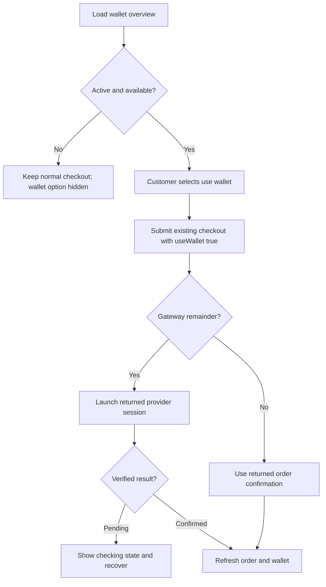
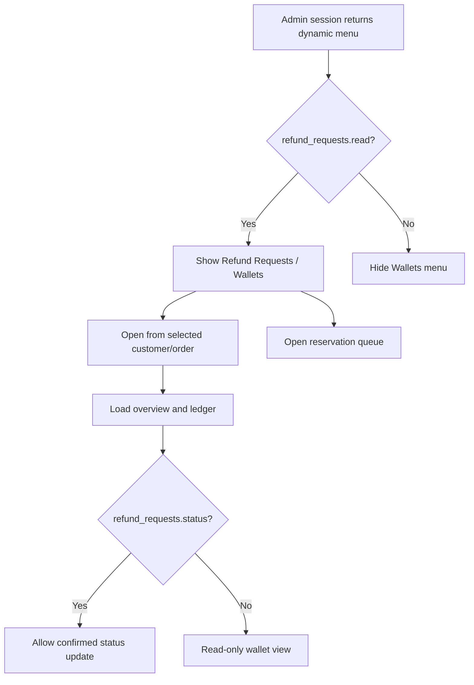

# Cureka Wallet: Frontend Integration Guide

This guide is for the storefront and admin frontend developers integrating with the existing Cureka backend wallet APIs. It covers customer wallet display, wallet checkout, admin wallet visibility and status controls, and refund destination behavior.

The backend owns wallet balances, pricing, reservations, payment allocation, settlement, and refund accounting. Frontends display backend results and call the existing APIs; they must not calculate or mutate wallet accounting themselves.

## Environments and common API behavior

- All paths below include the `/api` prefix.
- Use the environment-specific backend base URL already configured by the frontend application.
- Successful responses use `{ "success": true, "data": ..., "message": "...", "timestamp": "..." }`.
- Errors use HTTP status plus a response such as `{ "success": false, "error": "...", "message": "...", "statusCode": 400, "timestamp": "...", "path": "..." }`. Validation messages can be arrays. Use HTTP status for control flow and show the message as user-facing context; do not treat message text as a stable error code.
- Amounts described as rupee strings are INR decimal strings, for example `"125.50"`. Allocation fields ending in `Paise` are integer paise strings, for example `"12550"`. Never add rupee and paise values together.
- Use the frontend's shared API client, session/token refresh, response parsing, and error handling.

## Customer storefront integration

### Authentication and ownership

Customer wallet routes use the existing verified customer session cookie. Use the same authenticated client as the rest of the storefront. For cross-origin browser requests, send cookies (`credentials: 'include'` with `fetch`). Do not send a customer ID: the backend derives wallet ownership from the session. Customer wallet APIs are not authenticated by an admin bearer token.

### Customer endpoints

| Method and route | Use |
|---|---|
| `GET /api/wallet` | Current customer's wallet overview |
| `GET /api/wallet/transactions?page=1&limit=20` | Current customer's paginated ledger; page starts at 1, limit is 1–100 (default 20) |
| `POST /api/payment-requests/checkout` | Existing checkout/payment-link flow; optionally send `useWallet: true` |
| `POST /api/payment-requests/checkout/modal` | Existing modal checkout; optionally send `useWallet: true` |
| `POST /api/payment-requests/checkout/modal/verify` | Existing server-side verification for modal payments |
| `POST /api/payment-requests/checkout/modal/cancel` | Report modal dismissal; this does not prove the payment failed |
| `GET /api/orders/:id` | Load settled order status and payment allocation |
| `GET /api/returns/eligibility/:orderId` | Check return eligibility |
| `POST /api/returns` | Submit the existing return request |
| `POST /api/returns/:id/bank-details` | Choose/update the permitted destination for a COD refund portion |

Wallet checkout is off by default and controlled by backend configuration. The frontend cannot enable it. GoKwik wallet redemption is not available, and wallet use with COD is rejected by the backend.

### Wallet overview and transaction page

`GET /api/wallet` returns the `data` object:

```json
{
  "balance": "125.50",
  "reserved": "25.00",
  "available": "100.50",
  "currency": "INR",
  "status": "ACTIVE"
}
```

Show the three amounts separately. Label `available` as spendable. A reservation is held for an unsettled payment and must not be presented as spendable.

`GET /api/wallet/transactions?page=1&limit=20` returns paginated history:

```json
{
  "items": [
    {
      "id": "<ledger-uuid>",
      "direction": "CREDIT",
      "type": "COD_REFUND",
      "amount": "125.50",
      "balanceAfter": "125.50",
      "currency": "INR",
      "payoutId": "<payout-id-or-null>",
      "refundRequestId": "<refund-id-or-null>",
      "returnRequestId": "<return-id-or-null>",
      "paymentRequestId": "<payment-request-id-or-null>",
      "orderId": "<order-id-or-null>",
      "reservationId": "<reservation-id-or-null>",
      "createdAt": "2026-10-16T10:00:00.000Z"
    }
  ],
  "page": 1,
  "limit": 20,
  "total": 1,
  "totalPages": 1
}
```

Use `balanceAfter` as historical context only. Fetch the overview for the current available balance. Build a wallet page with loading, empty-history, error/retry, and populated states. Do not add customer top-up or debit controls; those APIs do not exist.

Example request using browser `fetch` (prefer the app's shared API client):

```ts
const response = await fetch(`${API_BASE_URL}/api/wallet`, {
  credentials: 'include',
  headers: { Accept: 'application/json' },
});
const result = await response.json();
if (!response.ok || !result.success) {
  throw new Error(Array.isArray(result.message) ? result.message.join(', ') : result.message);
}
const wallet = result.data;
```

### Add wallet use to existing checkout

Add a wallet-use control to the existing payment step. Show it only when the wallet is `ACTIVE`, available funds are greater than zero, the wallet checkout feature is enabled for the environment, and the active checkout flow supports it. The server remains authoritative; stale UI state can still be rejected.

Submit the existing checkout DTO with the boolean flag. The client must not send an amount:

```json
{
  "addressId": "<address-uuid>",
  "paymentMethod": "CASHFREE",
  "useWallet": true,
  "orderSource": "WEBSITE"
}
```

The backend calculates final eligible payable amount using authoritative cart pricing and applies the maximum eligible wallet contribution. For a partial payment, the returned response contains the gateway amount to charge:

```json
{
  "success": true,
  "data": {
    "gateway": "cashfree",
    "paymentData": {
      "paymentRequestId": "<payment-request-uuid>",
      "refId": "<payment-request-reference>",
      "paymentSessionId": "<cashfree-session>",
      "amount": 75.5,
      "totalAmount": "75.50",
      "walletAmount": "25.00",
      "gatewayAmount": "75.50",
      "eligibleTotal": "100.50",
      "prepaidDiscount": "0.00"
    }
  },
  "message": "Checkout session created successfully",
  "timestamp": "2026-10-16T10:00:00.000Z"
}
```

Show the returned wallet contribution, gateway remainder, and eligible total. Launch only the returned provider session through the existing Razorpay/Cashfree integration; do not create a second provider charge. The backend selects the active gateway. Do not reroute a pending attempt based on later gateway configuration changes.

If wallet contribution covers the full eligible total, the backend returns the existing order response and does not create a gateway session. Follow the existing order confirmation behavior without opening a provider SDK.

### Payment verification, timeout, and dismissal

The existing provider verification and webhook flow remains in use. For modal checkout:

- Razorpay verification body: `{ "razorpay_order_id": "...", "razorpay_payment_id": "...", "razorpay_signature": "..." }`.
- Cashfree verification body: `{ "cf_order_id": "...", "cf_payment_id": "..." }` (`cf_payment_id` is optional).
- Modal dismissal body: `{ "paymentRequestId": "<payment-request-uuid>" }`.

A successful verification response's `data` includes `paymentRequestId`, `refId`, and `totalAmount` (the gateway-paid portion). A timeout, local modal dismissal, or missing client callback is not proof of provider failure. Keep a pending/checking state, retain the payment request reference, and use existing recovery/status behavior. Do not tell the customer payment failed or assume reserved funds were released until the backend/provider has resolved the attempt.

After confirmed settlement, refresh wallet overview and order details. Order responses retain rupee totals and expose wallet/gateway allocation as integer paise strings. Divide paise by 100 for display; do not sum the paise fields with rupee amounts.

### Refund destination behavior

The existing return workflow can offer a wallet destination only for an eligible COD refund portion and only when the backend policy/configuration permits it. Prepaid gateway refunds remain tied to the original payment method. Do not offer wallet as a customer-selected destination for captured Razorpay/Cashfree amounts.

If available, use the existing endpoint:

```http
POST /api/returns/<return-id>/bank-details
Content-Type: application/json
```

```json
{ "refundMethod": "WALLET" }
```

Only display this choice when the backend allows the flow. Do not show a wallet credit as completed until the ledger/overview reflects the credit.

### Customer error handling

- `401`: use the normal customer session refresh or sign-in flow.
- `400`: display the validation/business message (for example, wallet disabled or unsupported checkout mode).
- `403`/`404`: show that the requested order/return is unavailable; never retry with another customer ID.
- `409`: refresh wallet overview and cart pricing, then ask the customer to retry.
- Network timeout: keep payment pending and resume existing verification/recovery; do not infer failure.

## Admin frontend integration

### Navigation, authentication, and permissions

The dynamic authenticated admin menu includes **Refund Requests → Wallets** at `/refund-requests/wallets` for users with `refund_requests.read`. Implement that page in the admin frontend. This backend repository provides the menu entry and APIs, not the frontend route/component.

Admin wallet APIs require an admin JWT, an allowed admin role (`SUPER_ADMIN`, `ADMIN`, or `MODERATOR`), and per-route permission checks. Send `Authorization: Bearer <admin-jwt>`; send `Content-Type: application/json` for status updates. Use the shared admin API client and session handling. Gate wallet lookup/history/queue UI on `refund_requests.read`, and gate status changes on `refund_requests.status`. Treat API `403` as authoritative; do not infer permissions from role labels alone.

There is no admin wallet search/list API. Open the wallet panel from an existing customer or order detail page using the selected customer UUID, or connect the page to the admin's existing customer search. Do not invent a wallet lookup endpoint.

### Admin endpoints

| Method and route | Permission | Purpose |
|---|---|---|
| `GET /api/admin/wallets/:customerId` | `refund_requests.read` | Wallet summary |
| `GET /api/admin/wallets/:customerId/transactions?page=1&limit=20` | `refund_requests.read` | Customer wallet ledger |
| `GET /api/admin/wallets/reconciliation/pending-reservations?page=1&limit=20` | `refund_requests.read` | Read-only pending reservation queue |
| `PATCH /api/admin/wallets/:customerId/status` | `refund_requests.status` | Set wallet status to `ACTIVE`, `FROZEN`, or `DISABLED` |

Pagination starts at 1; `limit` is 1–100 (default 20). Overview and ledger money values are rupee decimal strings. Reservation `amountPaise` and account `reservedBalancePaise` are integer paise strings.

Recommended page load: fetch customer overview and first ledger page in parallel; fetch the pending reservation queue in its own view/tab. Keep independent loading/error/retry states so one endpoint failure does not hide the other data.

### Customer wallet panel and status control

Show posted balance, reserved amount, available amount, and status. Ledger rows should show date, direction, type, amount, balance after, and business references when present. Paginate using response metadata.

Status update request:

```http
PATCH /api/admin/wallets/<customer-uuid>/status
Authorization: Bearer <admin-jwt>
Content-Type: application/json
```

```json
{ "status": "FROZEN" }
```

Require confirmation before changing status. Explain that inactive wallets cannot be newly reserved or debited, existing reservations remain held, and history is preserved. After success, use the returned account data and refresh overview. Do not optimistically report success before the server confirms it.

### Pending reservation queue and reconciliation

The queue response is paginated `{ items, page, limit, total, totalPages }`. Each item includes reservation ID, customer ID, payment request ID, order ID (possibly null), `amountPaise`, `status`, `idempotencyKey`, `expiresAt`, `settledAt`, and timestamps. Convert paise only for display (100 paise = INR 1).

This is a visibility endpoint only. There is no manual release/reconciliation action API. Expiry time is informational; a payment may still succeed late. Do not release or retry based only on expiry. Inspect the original payment attempt/provider through existing admin tools and follow the operational reconciliation process.

### Existing admin refund workflow

Use existing refund routes and state machine. Render server-provided original provider, approved amount, allocation, payout state, history, and `availableActions`. On approve, send `refundDestination` (`WALLET` default, or `BANK_ACCOUNT` when customer bank details exist on the return). After approve, initiate settles from that allocation: wallet credit does not call the payment gateway. Show initiate/reconcile/retry only when the backend action list and permissions allow.

Do not add manual wallet top-up, credit/debit adjustment, reservation release, or arbitrary refund destination controls; these endpoints are not implemented.

## Suggested screen flows

### Storefront



### Admin



## Feature availability and release notes

- `WALLET_CHECKOUT_ENABLED` is backend-controlled and defaults to `false`; frontend environment variables do not enable wallet checkout.
- GoKwik wallet redemption is a **separate** merchant-hosted integration (`/api/gokwik/apply-wallet-credit`, `/api/gokwik/remove-wallet-credit`). Keep `GOKWIK_WALLET_REDEMPTION_ENABLED=false` until GoKwik settlement contract questions are closed (see `docs/gokwik-wallet-contract-status.md` and `docs/gokwik-wallet-staging-checklist.md`). Native `useWallet` must not be sent on GoKwik checkout.
- Existing COD checkout without wallet and checkout without `useWallet` should remain available.
- Wallet foundation migrations are irreversible; soft rollback is flag-off + reservation reconciliation.
- For the full API and DTO reference, see `customer-wallet-api-integration.md` and `admin-wallet-api-integration.md` in the backend documentation.
